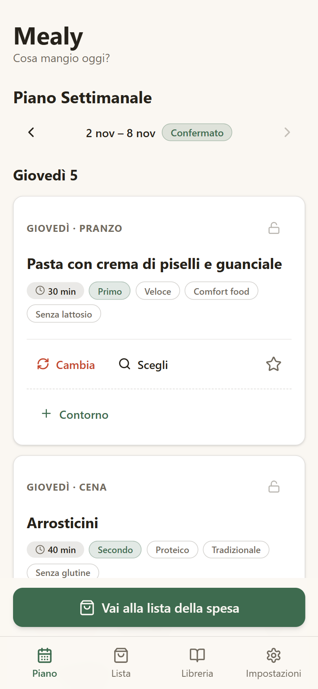
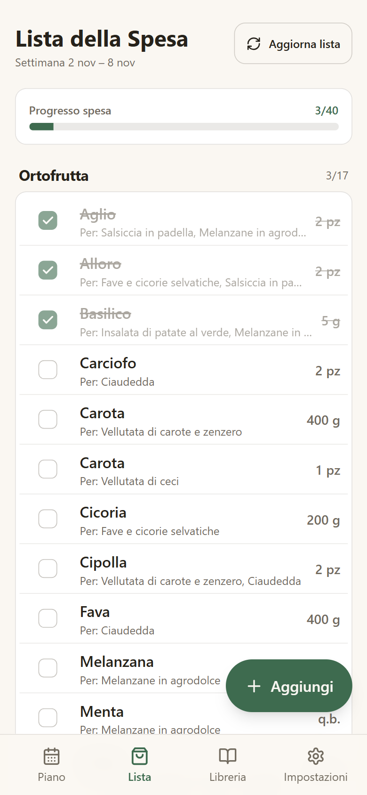
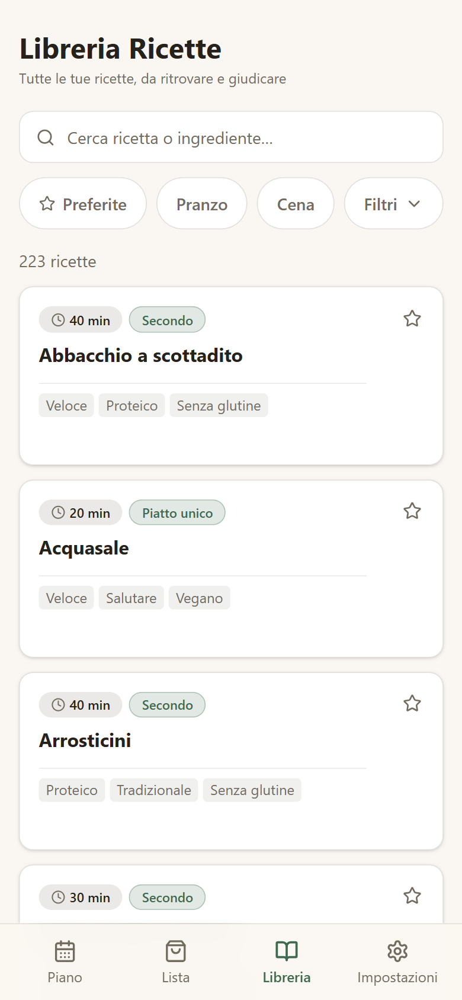
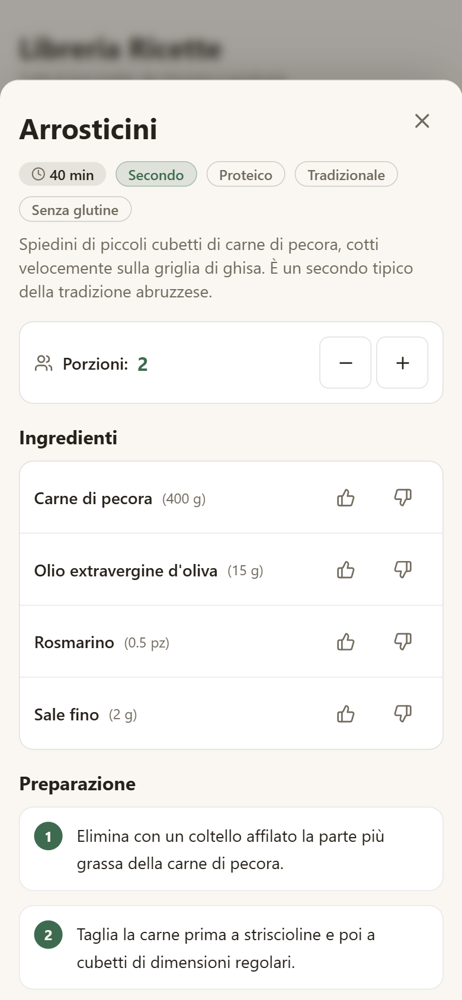
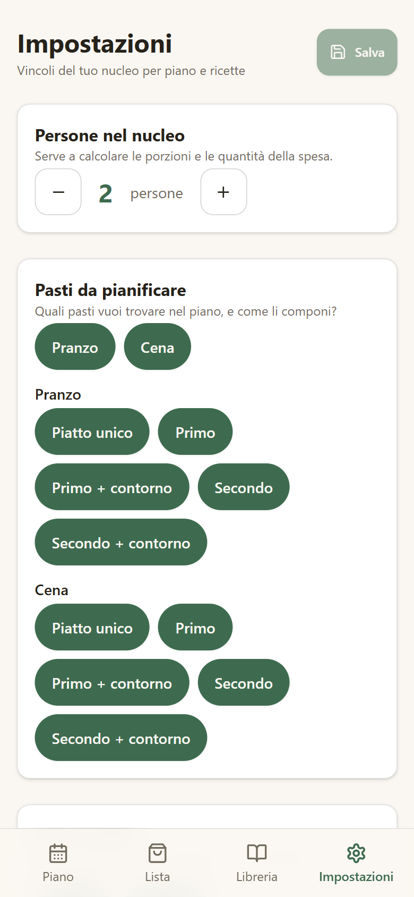

<h1 align="center">Mealy</h1>

<p align="center">
  <em>Cosa mangio oggi?</em><br>
  Il piano dei pasti della settimana e la lista della spesa, da una libreria di ricette<br>
  che cresce con te. Sul tuo server di casa, con il provider LLM che scegli tu.
</p>

<p align="center">
  <a href="LICENSE"></a>
  <a href="https://github.com/Elverle/Mealy/actions/workflows/image.yml"></a>
  <a href="package.json"></a>
</p>

<p align="center">
  
  &nbsp;
  
  &nbsp;
  
</p>

## Cos'è

**Mealy** è un'app web per chi ogni settimana si chiede cosa cucinare e poi cosa comprare. Compone il piano di pranzi e cene scegliendo dalla tua libreria di ricette, impara cosa ti piace dai voti che dai, e alla fine mette insieme la lista della spesa ordinata per reparto.

Non inventa ogni settimana da capo: **le ricette sono la libreria**. Il piano è una selezione pesata tra le ricette che hai già, e un modello linguistico (LLM) interviene solo quando la libreria non basta o quando gli chiedi qualcosa di preciso. Ogni ricetta che genera resta in libreria per le settimane dopo. La libreria parte già con 200 ricette italiane, quindi di solito il primo piano esce senza nessuna chiamata al modello.

Gira su un computer di casa tuo. Non c'è un nostro server, un account o un abbonamento: solo l'app, il suo database e il provider LLM che configuri.

## Funzionalità

- **Il piano della settimana in un tap.** Pranzo, cena o entrambi, con la composizione che preferisci: piatto unico, primo o secondo, con o senza contorno. *Genera piano* le alterna in modo bilanciato.
- **Cambiare idea costa poco.** *Cambia* sostituisce un piatto con un altro adatto, *Scegli* apre le ricette della libreria giuste per quel pasto, il lucchetto tiene fermo un pasto quando rigeneri. *Ripeti* ricopia una settimana passata.
- **Una libreria che cresce.** 200 ricette italiane di partenza (primi, secondi, piatti unici, contorni), ricerca per titolo o ingrediente e filtri. Se una ricetta non c'è, la chiedi all'LLM e la tieni solo se ti convince.
- **Preferenze che contano.** Voto da 1 a 5, ★ per le preferite, *Non proporre più* per quelle da evitare, 👍/👎 sui singoli ingredienti. Il piano successivo ne tiene conto.
- **La lista della spesa fatta da sola.** Gli ingredienti di tutta la settimana sommati, scalati sul numero di persone e ordinati come il giro al supermercato. Le spunte reggono anche quando la rete al supermercato non c'è.
- **I tuoi vincoli.** Numero di persone, diete (vegetariana, vegana, pescetariana, senza glutine, senza lattosio), stile dei pasti, elettrodomestici che hai in cucina.
- **Il provider lo scegli tu.** Google Gemini, OpenRouter, Anthropic o qualsiasi endpoint compatibile con OpenAI: si cambia con due variabili, senza toccare il codice.

## Installazione

Mealy gira su **qualsiasi macchina Linux a 64 bit con Docker** che tieni accesa in casa: un mini PC, un vecchio portatile, un NAS, un Raspberry Pi 4 (bastano 2 GB). Lo stack è Docker Compose: l'app, PostgreSQL 16 e un backup notturno del database.

> [!WARNING]
> **L'app non ha autenticazione.** Chiunque la raggiunga può modificare i dati e generare ricette con la tua chiave, a tue spese. Tienila raggiungibile solo dalla rete di casa e, da fuori, attraverso una VPN (Tailscale, WireGuard) o dietro un reverse proxy con login. Non aprire la porta su Internet.

### Cosa ti serve

- Una macchina Linux a 64 bit (`x86_64` o `aarch64`) con Docker, Docker Compose v2 e `git`.
- La chiave API di un provider LLM. Generare ricette costa quello che il provider fa pagare per i token; con la libreria di partenza le generazioni sono rare, e i piani di prova gratuiti di Gemini o OpenRouter bastano per cominciare.
- Facoltativa, per usarla dal telefono fuori casa: una VPN.

### Avvio

```bash
git clone https://github.com/Elverle/Mealy.git && cd Mealy
cp .env.production.example .env.production && chmod 600 .env.production
nano .env.production       # POSTGRES_PASSWORD, LLM_PROVIDER, LLM_MODEL e la chiave del provider
bash scripts/deploy.sh --build
```

Poi apri `http://<ip-del-server>:3000`, anche dal telefono. Al primo avvio l'app crea il database e carica da sola le ricette di partenza: sul server non si lancia nessun altro comando.

Per aggiornare a una versione nuova basta rilanciare `bash scripts/deploy.sh --build`: lo script fa un backup prima di toccare qualcosa. Su una macchina piccola puoi far costruire l'immagine a GitHub Actions dal tuo fork e lasciare che il server la scarichi soltanto.

La guida completa è [`docs/DEPLOY.md`](docs/DEPLOY.md): preparazione del server, Tailscale, immagini da GitHub Actions, backup e ripristino, aggiornamenti e ritorno a una versione precedente.

### Configurazione

Le variabili di `.env.production`; l'elenco completo, con i commenti, è in [`.env.production.example`](.env.production.example).

| Variabile | Obbligatoria | Esempio | A cosa serve |
| --- | --- | --- | --- |
| `POSTGRES_PASSWORD` | Sì | `openssl rand -hex 24` | Password del database, solo lettere e cifre |
| `LLM_PROVIDER` | Sì | `google` | Uno tra `google`, `openrouter`, `anthropic`, `openai-compatible` |
| `LLM_MODEL` | Sì | `gemini-3.1-flash-lite` | Il modello che scrive le ricette |
| `GOOGLE_GENERATIVE_AI_API_KEY`, `OPENROUTER_API_KEY`, `ANTHROPIC_API_KEY` | Quella del provider scelto | — | La chiave API; le altre restano vuote |
| `LLM_BASE_URL`, `LLM_API_KEY` | Solo per `openai-compatible` | `https://api.example.com/v1` | L'endpoint compatibile con OpenAI e la sua chiave |
| `LLM_TIMEOUT_MS` | No | `90000` | Quanto aspettare una risposta del modello, per un lotto di 3 ricette |
| `APP_PORT` | No | `3000` | Porta dell'app sul server |
| `BACKUP_DIR`, `BACKUP_KEEP`, `BACKUP_CRON` | No | `./backups`, `7`, `0 3 * * *` | Dove, quanti e quando salvare i backup |

## Primo avvio

1. Apri l'app: ti accoglie un percorso in cinque passi, già precompilato.
2. Indica **quante persone** siete, **quali pasti** pianificare (pranzo, cena o entrambi) e come li componi: piatto unico, primo, secondo, con o senza contorno.
3. Scegli lo **stile** dei pasti (veloce, salutare, proteico, tradizionale…), le **esigenze alimentari** e gli **elettrodomestici** che hai.
4. Sul **Piano** premi *Genera piano*. Ritocca quello che non ti convince con *Cambia* o *Scegli*, poi *Conferma piano*.
5. Premi *Crea lista della spesa*. Al supermercato apri la tab **Lista** e spunta man mano; *Aggiungi* mette in lista anche quello che non viene dalle ricette.

Da lunedì a venerdì si pianifica la settimana in corso, nel weekend quella dopo. Le frecce in alto mostrano le settimane passate. I vincoli si cambiano quando vuoi da **Impostazioni**.

<p align="center">
  
  &nbsp;
  
</p>

## Come funziona

### La libreria

Ogni ricetta ha ingredienti con quantità, passi, tempo, portate (piatto unico, primo, secondo, contorno), etichette di stile e diete compatibili. Gli ingredienti sono **normalizzati** quando la ricetta entra in libreria: un nome canonico, un'unità e un reparto presi da elenchi chiusi. È quello che permette di sommarli nella lista della spesa e di giudicarli uno per uno.

La libreria parte da un pacchetto di 200 ricette italiane, riscritte da un dataset e controllate a mano negli ingredienti. Cresce in tre modi: quando il piano ha bisogno di ricette che non ci sono, quando chiedi una ricetta dalla ricerca o dal selettore del Piano, e quando la tieni dopo averla vista.

### Il piano

Per ogni pasto Mealy filtra prima le ricette che **non possono** entrare: bloccate, della portata sbagliata, incompatibili con le tue diete o con i tuoi elettrodomestici, con un ingrediente che hai scartato, già presenti nella settimana. Tra quelle che restano sorteggia **con un peso**: contano il voto, la ★, quanto tempo è passato dall'ultima volta che l'hai mangiata, se è nuova, se contiene ingredienti che ti piacciono.

Nessun apprendimento automatico: la regola è scritta in chiaro in [`docs/ARCHITECTURE.md §5.2`](docs/ARCHITECTURE.md), e alla domanda "perché mi hai proposto questa?" c'è sempre una risposta. Solo quando per un tipo di pasto restano troppe poche ricette fresche il piano chiede al modello di scriverne di nuove, con i tuoi vincoli e la lista dei titoli da non ripetere.

### La lista della spesa

Nasce dal piano confermato e copre i pasti da oggi in poi. Le quantità di ogni ricetta si scalano sul numero di persone, gli ingredienti uguali si sommano anche quando hanno nomi diversi ("pomodori pelati" e "pelati"), e le righe si raggruppano nell'ordine del giro al supermercato: ortofrutta, pane, macelleria, pescheria, banco frigo, dispensa, surgelati, bevande.

Se cambi il piano dopo averla creata, la lista te lo segnala e *Aggiorna lista* la rifà tenendo le spunte che hanno ancora senso e gli articoli aggiunti a mano. Una spunta data senza rete resta a schermo e parte da sola quando la connessione torna.

## Privacy e dati

**Cosa esce dalla tua rete.** Solo le richieste al provider LLM che hai configurato, e solo quando serve una ricetta: i tuoi vincoli (persone, pasto, diete, stile, elettrodomestici), gli ingredienti che hai segnato come graditi o scartati, i titoli delle ricette già in libreria da non ripetere e, se la scrivi tu, la tua richiesta. Nient'altro: niente analytics, niente telemetria, nessun controllo degli aggiornamenti.

**Cosa resta a casa.** Ricette, piani, preferenze, liste e impostazioni stanno nel PostgreSQL che gira sulla tua macchina; i backup notturni nella cartella che scegli.

**Cosa non ti protegge.** L'app non ha login: la protezione è la rete. Chi la raggiunge può usarla tutta, compresa la tua chiave API. La chiave sta in chiaro in `.env.production` sul server, leggibile solo dal tuo utente (`chmod 600`).

## Problemi frequenti

| Cosa vedi | Cosa vuol dire di solito |
| --- | --- |
| *La generazione non è andata a buon fine. Riprova.* | Il provider non ha risposto in tempo o ha risposto male. Riprova; se succede spesso, controlla la chiave, prova un modello più capace o alza `LLM_TIMEOUT_MS` |
| Il piano propone sempre le stesse ricette | I vincoli sono stretti (diete, ingredienti scartati, elettrodomestici) e restano poche ricette adatte. Chiedine di nuove dalla ricerca della Libreria, o allenta un vincolo nelle Impostazioni |
| Lo script di deploy dice `Imposta POSTGRES_PASSWORD…` o `Imposta LLM_MODEL…` | Manca una variabile obbligatoria in `.env.production` |
| `la build dell'immagine non è riuscita` | Con `--build`, spesso memoria o disco insufficienti. L'app in funzione non è stata toccata; su una macchina piccola usa l'immagine di GitHub Actions |
| `lo stack non è diventato sano entro 180 secondi` | L'app non parte: leggi i log che lo script stampa, poi [`docs/DEPLOY.md §9`](docs/DEPLOY.md) |
| La porta 3000 è occupata | Un altro servizio sul server: metti `APP_PORT=3001` in `.env.production` e rilancia `bash scripts/deploy.sh --no-pull` |
| Fuori casa non risponde | La VPN è spenta sul telefono, oppure con Tailscale la chiave del server è scaduta |

L'elenco completo, con i rimedi, è in [`docs/DEPLOY.md §9`](docs/DEPLOY.md). Non hai risolto? [Apri una issue](https://github.com/Elverle/Mealy/issues) con cosa hai fatto, cosa ti aspettavi e cosa è successo.

## Come è sviluppato

Mealy è un monolite Next.js (App Router, TypeScript) con Tailwind CSS e shadcn/ui, PostgreSQL 16 con Drizzle ORM, schemi Zod come unica fonte dei tipi di dominio e il Vercel AI SDK per parlare con il modello. Il pianificatore, la lista della spesa e le preferenze sono funzioni pure, testate senza rete; solo il modulo delle ricette parla con l'LLM.

È sviluppato con [agentic-feature-factory](https://github.com/Elverle/agentic-feature-factory), il mio workflow guidato da agenti per Claude Code. Ogni feature segue la stessa pipeline: specifica, piano a work package, architecture review, implementazione test-driven con il gate di verifica, code review e documentazione. La traccia di quel lavoro fa parte del repository:

| Dove | Cosa c'è |
| --- | --- |
| [`docs/ARCHITECTURE.md`](docs/ARCHITECTURE.md) | Architettura, modello dati, la formula del piano, la lista della spesa, le API |
| [`docs/DESIGN.md`](docs/DESIGN.md) | Design system, schermate, microcopy e requisiti minimi di accessibilità |
| [`docs/BACKLOG.md`](docs/BACKLOG.md) | Epic, story e criteri di accettazione |
| [`docs/planning/`](docs/planning/) | Strategia di esecuzione, e per ogni feature specifica, piano e review |
| [`docs/wiki/`](docs/wiki/index.md) | La wiki tecnica del codice, una pagina per modulo |

## Sviluppo

### Requisiti

- Node.js 22 o superiore (la CI e l'immagine di produzione usano la 24)
- pnpm
- Docker con Docker Compose, per il PostgreSQL di sviluppo

### Avvio in locale

```bash
git clone https://github.com/Elverle/Mealy.git && cd Mealy
pnpm install
cp .env.example .env        # LLM_PROVIDER, LLM_MODEL e la chiave del provider
docker compose -f docker-compose.dev.yml up -d
pnpm db:migrate
pnpm db:seed
pnpm dev
```

`pnpm db:seed` carica qualche ricetta di esempio, non le 200 del pacchetto: per averle anche in sviluppo c'è `pnpm recipes:pack load`. I test non chiamano il modello e non servono chiavi: le risposte dell'LLM sono registrate in `tests/fixtures/llm/`.

Se la porta 5432 è già occupata, rimappala con un file di override:

```yaml
# docker-compose.dev.override.yml
services:
  postgres:
    ports: !override
      - "5433:5432"
```

Avvialo con `docker compose -f docker-compose.dev.yml -f docker-compose.dev.override.yml up -d` (Compose 2.24 o successivo) e aggiorna `DATABASE_URL` in `.env`. `pnpm test` non legge `.env`: per i test del database esporta `DATABASE_URL` anche nella shell.

### Comandi

| Comando | Cosa fa |
| --- | --- |
| `pnpm dev` | Server di sviluppo |
| `pnpm test` | Test Vitest (quelli del database vogliono il PostgreSQL Docker attivo e migrato) |
| `pnpm lint` · `pnpm typecheck` · `pnpm build` | ESLint, `tsc --noEmit`, build di produzione |
| `pnpm db:migrate` · `pnpm db:generate` | Applica le migrazioni; ne genera una nuova da `lib/db/schema.ts` |
| `pnpm db:seed` | Seed idempotente per lo sviluppo: nucleo di default, ricette di esempio, alias degli ingredienti |
| `pnpm db:seed:aliases` | Solo gli alias degli ingredienti (in produzione li carica l'app all'avvio) |
| `pnpm llm:record` | Registra una risposta reale del modello in `tests/fixtures/llm/recorded/` (serve una chiave) |
| `pnpm recipes:classify` | Assegna portate ed etichette alle ricette che non le hanno (in produzione lo fa l'app all'avvio) |
| `pnpm recipes:pack <passo>` | Prepara il pacchetto di ricette dal dataset `docs/recipe.csv`, che non è nel repository (`select` → `convert` → `ingredients` → `build`); `load` lo carica sul database |

Prima di una pull request deve passare il gate completo, lo stesso che gira in CI:

```bash
pnpm lint && pnpm typecheck && pnpm test && pnpm build
```

Per provare in locale lo stack di produzione: `docker build -t mealy-app:smoke . && bash scripts/smoke-prod.sh mealy-app:smoke`.

## Contribuire

Segnalazioni, idee e pull request sono benvenute. [`CONTRIBUTING.md`](CONTRIBUTING.md) spiega come procedere, le regole del codice e le convenzioni dei commit.

## Roadmap

Rinviato a dopo la v1, più o meno nell'ordine in cui servirebbe. I dettagli sono in [`docs/v2-funzionalita.md`](docs/v2-funzionalita.md).

- [ ] Un catalogo con tutte le ricette adatte del dataset (circa 2.500), cercabile per nome, ingrediente o etichetta
- [ ] Lo stile dei pasti scelto nelle Impostazioni nel peso del piano, e una quota fissa di ricette nuove ogni settimana
- [ ] Inserire e correggere le ricette a mano, con l'aiuto facoltativo del modello
- [ ] Richieste libere ("una cena leggera con le zucchine che ho in frigo") anche sul catalogo
- [ ] Login, per esporre l'app fuori dalla rete di casa, e uso condiviso in due
- [ ] Installazione come PWA, export e stampa di piano e lista

## Licenza

Mealy è distribuito con licenza MIT. Il testo completo è in [`LICENSE`](LICENSE).
