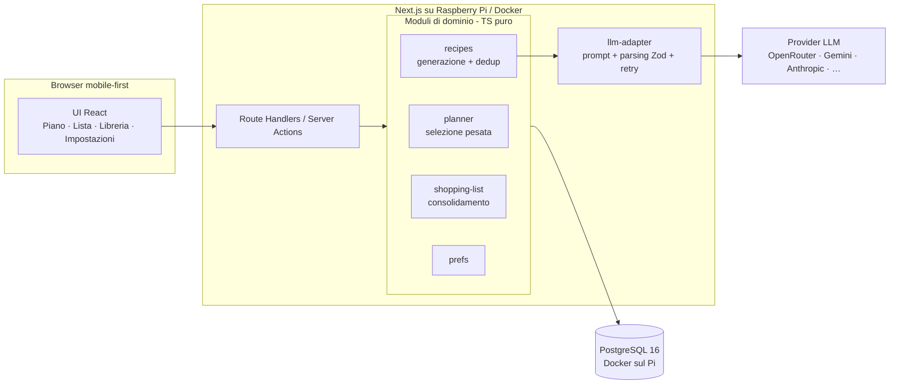

# Cosa Mangio Oggi — Documento di Architettura

**Versione:** 1.0 — 13 luglio 2026
**Stato:** Proposta
**Ambito:** applicazione personale (single user, predisposta per uso condiviso futuro)

---

## 1. Contesto e obiettivi

App web personale di meal planning che risponde alla domanda "cosa mangio oggi?". Genera un piano settimanale di ricette (pranzo e/o cena) rispettando i vincoli del nucleo domestico, produce la lista della spesa consolidata e spuntabile, e apprende le preferenze dell'utente per privilegiare certe ricette rispetto ad altre.

### 1.1 Obiettivi v1

- Piano settimanale pranzo/cena generato automaticamente da una **libreria di ricette persistente**
- Sostituzione della singola ricetta di uno slot ("non mi piace, cambiala")
- Sistema di **preferenze esplicite** (rating 1–5, preferita, bloccata) che pesa la selezione
- **Lista della spesa** consolidata, raggruppata per reparto, spuntabile, con persistenza della spunta
- Vincoli globali configurabili: numero persone, pasti da pianificare (pranzo/cena/entrambi) con la composizione di ciascuno (piatto unico, primo, primo + contorno, secondo, secondo + contorno), tipo pasti (veloce, salutare, proteico, poche calorie, …), esigenze alimentari (vegetariano, vegano, intolleranze), elettrodomestici disponibili

### 1.2 Non-obiettivi v1

- Nessuna selezione supermercato, nessun prezzo, nessun budget
- Nessuna autenticazione multiutente (l'app è usata da una sola persona; lo schema è però predisposto per l'uso condiviso in due — vedi §9)
- Nessun calcolo nutrizionale certificato: calorie/macro sono indicative (generate da LLM), non hanno valore clinico
- Nessuna app nativa: web mobile-first (la lista della spesa si usa dal telefono al supermercato)

### 1.3 Principio guida

> **Le ricette generate non sono usa-e-getta: sono la libreria.** Il piano settimanale è una *selezione pesata* dalla libreria, non una generazione da zero. L'LLM interviene solo per popolare la libreria quando il pool di candidate è insufficiente. Questo rende possibili le preferenze, abbatte i costi LLM e rende il piano deterministico e testabile.

Dalla Feature 10 la libreria parte da un **pacchetto iniziale** di 200 ricette (`fixtures/recipe-pack.json`: 50 primi, 50 secondi, 40 piatti unici, 60 contorni), riscritte da un dataset di ricette italiane e caricate all'avvio. Il modello completa la libreria quando il pool non basta, con lo swap e con le richieste dell'utente: con il pacchetto la generazione automatica diventa rara.

---

## 2. Stack

| Livello | Scelta | Motivazione |
|---|---|---|
| Framework | Next.js (App Router, TypeScript) | Full-stack in un repo, stesso stack di CashFlow Casa, deploy Vercel nativo |
| UI | Tailwind CSS + shadcn/ui | Velocità, componenti accessibili, vedi `DESIGN.md` |
| Database | PostgreSQL | Relazionale è il fit naturale (ricette↔piani↔preferenze), familiarità |
| ORM | Drizzle ORM + drizzle-kit (migrazioni) | Type-safe, leggero, SQL-first, driver serverless Neon supportato |
| Validazione | Zod | Contratto unico per input API e output LLM |
| LLM | Vercel AI SDK (`generateObject` + Zod) con provider intercambiabile via env | Provider-agnostico: OpenRouter (anche modelli gratuiti), Gemini, Anthropic, … — si cambia con due variabili d'ambiente |
| Deploy | Raspberry Pi (Docker Compose + Tailscale) (Opzione C, §8) | Self-hosted, privacy totale, zero costi, niente login necessario in v1 |

---

## 3. Architettura ad alto livello

Monolite Next.js full-stack. Nessun servizio separato: la logica di dominio vive in moduli TypeScript puri (testabili in isolamento), esposti tramite Route Handlers / Server Actions.



Regole di dipendenza:

1. `planner`, `shopping-list`, `prefs` sono **funzioni pure + repository**: nessuna chiamata LLM al loro interno. Solo `recipes` parla con `llm-adapter`.
2. `llm-adapter` è l'unico punto che conosce il provider: prompt, schema di output, retry/repair. Il provider concreto è **configurazione, non codice**: si seleziona con `LLM_PROVIDER` + `LLM_MODEL` (vedi §7); cambiare provider non tocca nessun altro modulo.
3. Le entità condivise (tipi `Recipe`, `Ingredient`, enum unità/reparti/tag) vivono in `lib/domain/types.ts` e sono derivate dagli schemi Zod (single source of truth).

---

## 4. Modello dati

### 4.1 Decisione chiave: ingredienti normalizzati alla fonte

Il consolidamento della lista della spesa (sommare "200 g di petto di pollo" + "150 g di petto di pollo" tra ricette diverse) è deterministico **solo se gli ingredienti nascono già normalizzati**. Quindi il contratto di generazione LLM impone:

- `canonical_name`: minuscolo, singolare, senza aggettivi di preparazione ("petto di pollo", non "Petti di pollo tagliati a cubetti" — la preparazione va nei passi della ricetta)
- `unit`: enum chiuso → `g | ml | pz | qb` (l'LLM converte: kg→g, l→ml, "2 spicchi"→pz con nota; `qb` = quanto basta, senza quantità)
- `category`: enum chiuso dei reparti → `ortofrutta | macelleria | pescheria | banco-frigo | dispensa | surgelati | pane | bevande | altro`

La tabella `ingredient_aliases` assorbe nel tempo i sinonimi residui ("pomodori pelati" ≡ "pelati").

### 4.2 Schema (Drizzle → Postgres)

```
households                 -- singleton in v1, chiave di partizione futura
  id, persons int, meals text[] ('pranzo','cena'),
  meal_compositions jsonb,          -- { pranzo: [...], cena: [...] }: composizioni ammesse per pasto, default tutte e cinque
  diet_tags text[], meal_style_tags text[], appliances text[],
  onboarded_at timestamptz null,    -- null = wizard di primo avvio non completato
  created_at, updated_at            -- updated_at = ultimo cambio dei vincoli (now() del DB)

recipes
  id, household_id FK,
  title text, slug text unique,
  description text, steps jsonb (string[]),
  meal_types text[] ('pranzo','cena'),
  courses text[] ('piatto-unico','primo','secondo','contorno'; vuoto = non classificata),
  tags text[] (11 etichette di stile, vedi sotto),
  diet_flags text[] (vegetariano, vegano, senza-glutine, ...),
  appliances_required text[],
  servings_base int, prep_minutes int,
  kcal_est int null, macros_est jsonb null,
  source text ('llm','manual'), created_at

recipe_ingredients
  id, recipe_id FK,
  canonical_name text, display_name text,
  qty numeric null, unit text ('g','ml','pz','qb'),
  category text (enum reparti),
  note text null

recipe_prefs               -- 1:1 con recipes in v1; PK (recipe_id) → (recipe_id, user_id) in v2
  recipe_id FK PK,
  rating int null (1..5), favorite bool default false, blocked bool default false,
  times_used int default 0, last_used_at timestamptz null

meal_plans
  id, household_id FK, week_start date, status ('draft','active','archived'),
  created_at,
  generated_at timestamptz     -- ultima (ri)generazione; piano superato se households.updated_at > generated_at
  unique (household_id, week_start)

plan_slots                 -- un slot per piatto: il pasto è il gruppo di slot con lo stesso (day, meal)
  id, plan_id FK, day date, meal text ('pranzo','cena'),
  course text ('piatto-unico','primo','secondo','contorno'),  -- portata del piatto nel pasto
  recipe_id FK, servings int,
  locked bool default false      -- il lucchetto vale per il pasto: tutti i suoi slot hanno lo stesso valore
  unique (plan_id, day, meal, (course = 'contorno'))          -- al più un principale e un contorno per pasto

shopping_lists             -- 1:1 con meal_plans
  id, plan_id FK unique, generated_at,
  needs_regeneration bool default false  -- impostato da swap, rigenerazione e Ripeti su un piano esistente (F4), azzerato alla rigenerazione della lista (F6)

shopping_items
  id, list_id FK,
  canonical_name text, qty numeric null, unit text null, category text,   -- unit null = articolo aggiunto a mano
  checked bool default false, manual bool default false,  -- item aggiunti a mano
  recipe_ids uuid[]          -- tracciabilità: da quali ricette proviene

ingredient_aliases
  alias text PK, canonical_name text

ingredient_prefs           -- popolata lazy: solo gli ingredienti su cui si è espresso un giudizio
  household_id FK, canonical_name text,   -- PK (household_id, canonical_name); canonical_name normalizzato
  pref text ('like','dislike'),
  created_at
```

Indici principali: `recipes(household_id)`, GIN su `recipes.tags/diet_flags`, `pg_trgm` su `recipes.title` per il dedup, `shopping_items(list_id, category)`, e l'unico `plan_slots(plan_id, day, meal, (course = 'contorno'))` (`plan_slots_plan_day_meal_side_idx`), che sostituisce quello su `(plan_id, day, meal)`.

**Portate ed etichette di stile.** `recipes.courses` è un elenco chiuso e multiplo: `piatto-unico | primo | secondo | contorno` (`COURSE_VALUES`, `COURSE_LABELS` in `lib/domain/types.ts`). Vuoto = **non classificata**: sono tali le ricette salvate prima della portata, che la migrazione `0005` lascia senza portate. Le portate **principali** sono `piatto-unico`, `primo`, `secondo` (`MAIN_COURSE_VALUES`). Una ricetta non classificata è idonea a ogni principale e mai a un contorno; una classificata è idonea alle portate che ha (regole di §5.2). Una ricetta solo contorno non fa da piatto principale.

Le etichette di stile (`tags`) sono undici: `veloce`, `salutare`, `proteico`, `leggero`, `comfort-food`, `economico`, `tradizionale`, `dal-mondo`, `pochi-ingredienti`, `in-anticipo`, `piatto-freddo`. `piatto-unico` non è un'etichetta: è una portata, e nel pasto la rappresenta la composizione (Feature 11). La migrazione `0006` la toglie da `households.meal_style_tags` e da `recipes.tags`. Una regola derivata vale sul modello (`deriveStyleTags` in `lib/domain/courses.ts`; la migrazione `0005` la applica anche alle ricette esistenti): `pochi-ingredienti` c'è se e solo se la ricetta ha al massimo 6 ingredienti con unità diversa da `qb`.

Le regole pure di portata (`normalizeCourses`, `coursesAllowed`, `isMainDish`, `courseLabel`) stanno in `lib/domain/courses.ts`: le altre parti del codice le riusano senza ripeterle.

**Composizioni del pasto (Feature 11).** Un pasto è il gruppo di slot di un piano con lo stesso giorno e pasto: un principale (portata `piatto-unico`, `primo` o `secondo`) e, solo con un primo o un secondo, un contorno (portata `contorno`). Ogni piatto è una riga di `plan_slots`, con la sua `course`; l'indice unico ammette al più un principale e un contorno per pasto. La composizione non si memorizza: si ricava dalle portate dei piatti (`mealCompositionOf`). Le composizioni sono cinque, in quest'ordine: `piatto-unico`, `primo`, `primo-contorno`, `secondo`, `secondo-contorno` (`MEAL_COMPOSITION_VALUES`, `MEAL_COMPOSITION_LABELS` in `lib/domain/types.ts`). `households.meal_compositions` (`{ pranzo, cena }`) elenca quelle ammesse per ogni pasto, validato da `MealCompositionsSchema` in lettura e in scrittura: almeno una per pasto, e per default tutte e cinque, sia per pranzo sia per cena. Le regole pure stanno in `lib/domain/compositions.ts`.

**Migrazioni.** `0006` toglie l'etichetta `piatto-unico`. `0007` aggiunge `households.meal_compositions` (default tutte e cinque) e `plan_slots.course`, ricavata per ogni slot esistente dalla ricetta: la prima tra `piatto-unico`, `primo`, `secondo` che la ricetta ha, altrimenti `piatto-unico`. I piani esistenti hanno un solo piatto per pasto e nessun contorno: li ricompone solo *Rigenera*. Tornare a una versione precedente passa solo dal dump (`docs/DEPLOY.md §6`).

---

## 5. Logiche core

### 5.1 Generazione ricette (LLM)

Input: vincoli household + `meal_type` + numero di ricette richieste + lista titoli già in libreria (per evitare duplicati) + ingredienti `like` ("privilegia quando sensato") e `dislike` ("non usare mai").

Contratto di output (Zod, schema JSON stretto):

```jsonc
{
  "recipes": [{
    "title": "…",
    "description": "…",
    "meal_types": ["cena"],
    "courses": ["secondo"],
    "tags": ["veloce", "proteico"],
    "diet_flags": ["vegetariano"],
    "appliances_required": ["fornelli"],
    "servings_base": 2,
    "prep_minutes": 25,
    "kcal_est": 520,
    "steps": ["…", "…"],
    "ingredients": [
      { "canonical_name": "petto di pollo", "display_name": "petto di pollo a cubetti",
        "qty": 300, "unit": "g", "category": "macelleria" }
    ]
  }]
}
```

Pipeline: prompt → parse Zod → **se fallisce, 1 retry di "repair"** (si rimanda l'errore di validazione al modello) → dedup contro la libreria (titolo normalizzato + similarità `pg_trgm` > 0.6 ⇒ scarta) → insert transazionale ricetta+ingredienti+pref di default.

**Portate nella generazione.** Ogni ricetta generata ha almeno una portata (`courses`), nello schema di output. I vincoli di generazione portano `courses`, dove `null` vuol dire qualsiasi portata: il Piano e lo swap chiedono portate principali, oppure la sola `contorno` quando riempiono un contorno; la richiesta dal Piano le chiede principali (o `contorno` dal selettore del contorno), quella dalla Libreria qualsiasi. `POST /api/recipes/generate` genera con le portate principali (`GenerateAndStoreInput.courses`, default `MAIN_COURSE_VALUES`); il Piano passa per ogni carenza la portata della carenza. Una ricetta che non rispetta la portata richiesta è scartata come le altre violazioni di vincolo (`findConstraintViolations`, con la violazione «portata non adatta al pasto»). La regola derivata di §4.2 (`pochi-ingredienti`) si applica in `insertGeneratedRecipe` e alla proposta salvata.

Costi: un batch da 5 ricette ≈ pochi migliaia di token ⇒ centesimi. A regime la libreria copre quasi tutto e l'LLM si chiama di rado.

**Richiesta libera.** L'utente può chiedere una ricetta con un testo (da 3 a 100 caratteri), dalla Libreria o dal selettore del Piano. `recipes` chiama l'adapter per **una** ricetta: il prompt riporta la richiesta come dato tra due delimitatori, più persone, tipo di pasto e portata imposti dal Piano (una principale, oppure un contorno quando la richiesta viene dal selettore del contorno, `side_dish`), diete ed elettrodomestici e, nella sequenza di *Un'altra*, i titoli già proposti; **non** contiene stile preferito, ingredienti graditi o scartati, né i titoli della libreria. La proposta che viola diete, elettrodomestici, il tipo di pasto o la portata non viene restituita (`422 proposal_unsuitable`, senza secondo tentativo). La proposta **non si salva**: vive nel browser finché l'utente non la accetta. Il salvataggio (`POST /api/recipes`) rivalida la ricetta per intero, ricontrolla diete ed elettrodomestici sulle impostazioni rilette e rifiuta il titolo identico (titolo normalizzato): il controllo di somiglianza `pg_trgm` non si applica, perché chi chiede "lasagne al pesto" avendo già "Lasagne al ragù" vuole proprio una variante.

### 5.2 Selezione pesata per il piano settimanale

**Composizioni dei pasti da riempire.** Prima della selezione, ogni pasto da riempire prende una composizione tra quelle ammesse per il suo tipo di pasto (`households.meal_compositions`), con `distributeCompositions`. Per ogni tipo di pasto, con `n` pasti da riempire e `k` composizioni ammesse, ognuna esce `⌊n/k⌋` volte; le `n mod k` uscite in più vanno a composizioni sorteggiate senza ripetizioni. Poi le uscite si mescolano e si assegnano ai giorni in ordine: niente sei cene uguali su sette. Un unico seme serve a tutta la costruzione del piano, quindi a parità di input e di `rng` il risultato, composizioni comprese, è lo stesso. I pasti tenuti (giorni passati e pasti bloccati) restano con la loro composizione e non entrano nel bilanciamento. Ogni composizione produce uno slot per piatto (il principale con la sua portata, più il contorno se previsto), e la selezione pesata riempie ciascuno.

Per ogni slot da riempire, il pool di candidate è filtrato per vincoli **duri** (esclusioni), poi campionato con peso (weighted random senza reinserimento nella settimana).

Esclusioni (hard):
- `blocked = true`
- `meal_type` non compatibile con lo slot
- `course`: la portata della ricetta non fa per lo slot (`fitsCourse`). Uno slot principale di portata `c` vuole una ricetta con `c` tra le sue portate, oppure non classificata. Uno slot contorno vuole una ricetta con `contorno` tra le sue portate: una ricetta non classificata non fa mai da contorno. Una ricetta con più portate (per esempio `['secondo','piatto-unico']`) è candidata per ognuna di esse
- `diet_flags` che non soddisfano le esigenze household
- `appliances_required` ⊄ elettrodomestici disponibili
- contiene almeno un ingrediente con pref `dislike`
- già selezionata in questa settimana, contorni compresi (max 1 occorrenza per piano: nessuna ricetta compare due volte)

Peso (soft):

```
peso(r) = ratingFactor × favoriteBoost × recencyDecay × noveltyBonus × ingredientAffinity

ratingFactor  = 1                       se rating assente
              = 0.25 + rating / 4       → 0.5 … 1.5
favoriteBoost = 1.5 se favorite, altrimenti 1
recencyDecay  = 1                        se mai usata
              = 0.15                     se last_used_at < 10 giorni fa   (recencyFloor)
              = lineare 0.15 → 1         tra 10 e 28 giorni
              = 1                        oltre 28 giorni
              (le preferite non hanno pausa: recencyDecay = max(favoriteRecencyFloor = 1, decadimento))
noveltyBonus  = 1.2 se times_used = 0    (fa ruotare le ricette nuove)
ingredientAffinity = 1 + 0.15 × min(2, n° ingredienti con pref like)   → 1 … 1.3
```

Ogni candidata idonea ha quindi peso > 0: una ricetta usata da poco resta sorteggiabile, ma molto meno probabile. `last_used_at` è il **giorno del pasto** (mezzogiorno UTC dello slot più recente in cui la ricetta è stata confermata), non l'istante della conferma; una ricetta pianificata nel futuro pesa `recencyFloor`.

**Quando serve la generazione (`needMore`).** Le carenze sono per coppia (tipo di pasto, portata), contorni compresi. Per ogni coppia si contano le candidate idonee e **fresche** (mai usate, usate da almeno 10 giorni, oppure preferite; per la portata `contorno` contano solo le ricette che hanno `contorno`, e una non classificata non fa da contorno): se sono meno di `slot + soglia − 1` (soglia di default 3), o se resta uno slot senza candidata, il planner segnala la carenza e `plans` chiede a `recipes` nuove ricette per quel `meal_type` e quella portata con i vincoli correnti, poi riprova (al più `maxGenerationRoundsPlan` giri). Il numero richiesto per coppia è il deficit più 2 (min 3, max 10). Per tipo di pasto, però, un giro richiede al più 10 ricette in tutto: le carenze di quel tipo se le dividono con `planGeneration`, prima quelle con slot vuoti, poi nell'ordine delle carenze. Ogni richiesta viene **suddivisa in lotti da 3** (`generationBatchSize`, es. 10 → 3+3+3+1): tutti i lotti di tutti i tipi di pasto e di tutte le portate partono in parallelo in un solo giro, così la durata di un giro resta quella di una chiamata da 3 ricette. Alla conferma del piano si aggiornano `times_used` e `last_used_at`.

**Concorrenza.** La chiamata LLM sta sempre fuori dalle transazioni; la selezione che decide cosa scrivere gira invece **dentro** la transazione, dopo l'advisory lock del piano, sullo stato riletto (piano e libreria). La selezione fuori dalla transazione serve solo a decidere se generare. La conferma è una transizione condizionata `draft → active`: `times_used` si incrementa una volta sola anche con richieste sovrapposte. Aggiunta e rimozione del contorno, cambio di composizione e blocco del pasto seguono la stessa regola; l'indice unico di §4.2 è l'ultima difesa contro un doppio «+ Contorno».

I parametri (10/28 giorni, `recencyFloor`, boost, soglia, lotti) sono costanti in `lib/domain/planner-config.ts`: tarabili senza toccare la logica.

### 5.3 Swap di uno slot

Stesso algoritmo di 5.2 applicato al singolo piatto, che tiene la sua portata: un *Cambia* sul principale prende una ricetta della stessa portata, un *Cambia contorno* un altro contorno. Exclude-list = ricetta attuale + tutte le altre del piano + le ricette già scartate nella stessa sequenza di *Cambia* (inviate dal client in `exclude_recipe_ids`, al più `SWAP_EXCLUDE_MAX`). I pasti dei giorni già passati non si cambiano (`409 slot_past`). Lo swap invalida la lista della spesa se già generata (flag "lista da rigenerare" sulla UI, rigenerazione esplicita che preserva le spunte dove possibile, con la chiave e le regole di §5.5).

**Scelta a mano.** Accanto allo swap, l'utente può mettere in uno slot una ricetta precisa della libreria. È adatta a un piatto una ricetta non bloccata, di quel tipo di pasto, che rispetta le diete dell'household e richiede solo elettrodomestici disponibili (`manualChoiceExclusionReason` in `lib/domain/planner.ts`): sul principale con una qualsiasi portata principale, sul contorno solo con `contorno`. Gli ingredienti «non mi piace» e la presenza in un altro pasto della settimana **non** la escludono; la esclude invece la presenza nell'altro piatto dello stesso pasto (la stessa ricetta non fa da principale e da contorno insieme: `recipe_not_eligible`). L'assegnazione gira in una transazione sotto il lock dei piani, sullo stato riletto, e ha gli stessi effetti dello swap: aggiorna `times_used` e `last_used_at` se il piano è confermato e segna la lista della spesa da aggiornare. Nessuna chiamata LLM: se la ricetta voluta non c'è, il client la chiede a `recipes`, la salva e poi la assegna.

**Scegli sul principale.** La ricetta scelta fissa la portata del principale: tiene la portata attuale se la ricetta ce l'ha; altrimenti, con un contorno nel pasto, prende `primo` o `secondo` (primo prima di secondo); altrimenti la prima tra `piatto-unico`, `primo` e `secondo` che la ricetta ha. Una ricetta non classificata tiene la portata attuale. Se la portata risultante è `piatto-unico`, il contorno del pasto si toglie nella stessa operazione. La composizione che ne esce può non essere tra quelle ammesse nelle Impostazioni: la scelta a mano vince, come già vince sugli ingredienti scartati.

**Contorno.** «+ Contorno» aggiunge a un primo o a un secondo senza contorno uno slot contorno, riempito come un *Cambia* (selezione pesata, esclusioni del piano, modello solo se serve). Rifiuta un piatto unico (`side_not_allowed`) e un pasto che ha già il contorno (`side_exists`). *Togli contorno* cancella lo slot contorno, senza conferma, e rifiuta uno slot principale (`not_a_side_dish`): il principale non cambia. *Cambia contorno* sostituisce il contorno con un altro, con le regole dello swap, e i contorni scartati nella sequenza si escludono come quelli del principale. *Scegli contorno* elenca solo i contorni idonei.

**Blocco.** Il lucchetto, sulla card o con il long-press, blocca o sblocca tutti i piatti del pasto: il pasto è l'unità del blocco. Un pasto bloccato rifiuta *Cambia*, *Scegli*, «+ Contorno» e *Togli contorno* (`slot_locked`). *Rigenera* tiene i pasti bloccati con tutti i loro piatti.

**Ripeti.** *Ripeti* copia la composizione di ogni pasto della settimana di origine, anche se non è più tra quelle ammesse, e per ogni piatto la stessa ricetta se è ancora idonea per quella portata. Un piatto la cui ricetta non è più idonea si riempie con il planner nella stessa portata; i pasti che nell'origine mancano prendono le composizioni ammesse, bilanciate.

Ogni azione che cambia i piatti segna la lista della spesa da rifare. Su un piano confermato, la ricetta che entra conta un uso (`times_used`, `last_used_at`); quella che esce non perde l'uso.

### 5.4 Preferenze

Solo segnali espliciti in v1, su **due livelli**: la **ricetta** (rating 1–5, preferita, bloccata) e il **singolo ingrediente** (like/dislike su `canonical_name`). Le preferenze ingrediente si popolano man mano dalle ricette proposte — nessuna anagrafica ingredienti da riempire a priori: la chiave `canonical_name` esiste già grazie alla normalizzazione di §4.1. Un `dislike` è un filtro duro (esclude dalla selezione e dalla generazione LLM); un `like` è un boost morbido. Vale per il sorteggio: una ricetta chiesta apposta o scelta a mano si può salvare e mettere nel piano anche se contiene un ingrediente scartato, e il sorteggio continua comunque a non proporla. Poiché scartare un ingrediente molto comune (es. cipolla) può escludere una fetta ampia di libreria, la UI mostra l'impatto prima di confermare ("escluderà N ricette"). `times_used`/`last_used_at` si aggiornano automaticamente alla conferma del piano e alimentano recency e novelty. Nessun machine learning: la formula di 5.2 è trasparente e spiegabile ("perché mi hai proposto questa?" ha una risposta leggibile). Bloccare una ricetta la toglie anche dalle preferite. Ogni giudizio (su ricetta o ingrediente) vale dalla selezione successiva — generazione, rigenerazione, *Ripeti* o *Cambia* — e non modifica un piano già composto. L'impatto mostrato prima di scartare un ingrediente è il numero di ricette non bloccate della libreria che lo contengono; gli alias non si risolvono. Il confronto è sul nome canonico esatto: varianti come «cipolla rossa» sono ingredienti distinti e si giudicano a parte.

### 5.5 Consolidamento lista della spesa

Funzione pura `buildShoppingList(slots, aliases) → items` (`lib/domain/shopping-list.ts`). La lista copre i pasti **da oggi in poi** del piano confermato:

1. **Scala** le quantità di ogni ricetta: `qty × servings_slot / servings_base`. Ogni slot è un piatto, contorni compresi: un pasto con contorno entra nella lista con tutti i suoi piatti, alle porzioni del pasto
2. **Risolve gli alias** via `ingredient_aliases` (un solo passo) e **aggrega** per chiave `(canonical_name, unit)` sommando le quantità; gli item senza quantità (`qb`) si uniscono in una riga sola, che sparisce se lo stesso nome ha anche una riga con quantità
3. **Arrotonda** per eccesso: `pz` → intero; `g` e `ml` → multipli di 10 (fino a 10 → intero)
4. **Raggruppa** per `category` (decisa per nome, a maggioranza tra le ricette che lo usano) nell'ordine tipico del giro al supermercato: ortofrutta → pane → macelleria → pescheria → banco-frigo → dispensa → surgelati → bevande → altro
5. Mantiene `recipe_ids` per item (sotto il nome: "Per: X, Y")

**Creazione e aggiornamento.** Solo per piani confermati e non chiusi, in una transazione sotto il lock del piano. L'aggiornamento riconcilia per `(canonical_name, unit)`: le righe che restano tengono il loro id; la spunta resta se la quantità non aumenta (per `qb` resta sempre); gli articoli aggiunti a mano non si toccano; `needs_regeneration` torna `false`. Il confronto è tra la quantità di prima e quella dei soli pasti che restano: dopo un cambio a metà settimana può restare spuntato un articolo di cui serve ancora una parte.

**Articoli a mano.** Solo il nome (normalizzato, senza risolvere l'alias); il reparto si deduce dalla libreria (stesso nome, alias risolti), altrimenti `altro`; `unit` e `qty` restano `null`. L'aggiunta prende il lock dei piani dell'household (lo stesso della creazione della lista), così che due aggiunte sovrapposte dello stesso nome diano un solo articolo: la seconda trova quello della prima e risponde `created: false`.

**Spunte senza rete.** La spunta è un valore assoluto (`PATCH { checked }`): il client la applica subito, la tiene in una coda salvata in `localStorage` e la ritenta finché il server risponde.

**Alias.** Si risolvono solo qui: ricette, preferenze ingrediente e planner continuano a confrontare il nome canonico esatto (§5.4).

Casi limite accettati in v1: unità eterogenee per lo stesso ingrediente (es. "pz" e "g" di limone) restano su due righe; la tabella alias riduce il fenomeno nel tempo.

---

## 6. Superficie API

Route Handlers sotto `/api` (o Server Actions equivalenti — scelta implementativa per story):

| Metodo | Rotta | Funzione |
|---|---|---|
| GET/PUT | `/api/settings` | Vincoli household, composizioni dei pasti incluse (`meal_compositions`) |
| GET | `/api/recipes?filter…` | Libreria con filtri/ricerca |
| POST | `/api/recipes/generate` | Genera N ricette via LLM e le salva |
| POST | `/api/recipes/propose` | Propone una ricetta da una richiesta in testo libero (`{ request, meal_type?, side_dish?, exclude_titles? }`; con `side_dish` propone un contorno); non salva nulla |
| POST | `/api/recipes` | Salva in libreria una ricetta proposta (`{ recipe }`), dopo averla rivalidata |
| GET | `/api/recipes/:id` | Dettaglio |
| PUT | `/api/recipes/:id/pref` | Rating / preferita / bloccata |
| GET | `/api/ingredient-prefs` | Elenco like/dislike sugli ingredienti |
| PUT | `/api/ingredient-prefs/:canonicalName` | Imposta o rimuove like/dislike (con conteggio ricette impattate) |
| POST | `/api/plans` | Genera (o rigenera) il piano della settimana da pianificare (calcolata dal server) |
| GET | `/api/plans/current` | Schermata del Piano: piano mostrato, settimana da pianificare e azione disponibile |
| GET | `/api/plans/current?settimana=YYYY-MM-DD` | Come sopra, sulla settimana indicata (navigatore; valori non validi o oltre la settimana da pianificare sono ignorati) |
| POST | `/api/plans/:id/slots/:slotId/swap` | Sostituisce la ricetta dello slot (il piatto mantiene la sua portata) |
| POST | `/api/plans/:id/slots/:slotId/side` | Aggiunge un contorno al pasto dello slot principale indicato (`{ exclude_recipe_ids }`, come lo swap) |
| PATCH | `/api/plans/:id/slots/:slotId` | Blocca/sblocca il pasto dello slot, tutti i suoi piatti (`{ locked }`) |
| DELETE | `/api/plans/:id/slots/:slotId` | Toglie il contorno: lo slot deve essere un contorno |
| GET | `/api/plans/:id/slots/:slotId/candidates` | Ricette della libreria adatte allo slot, per la scelta a mano |
| PUT | `/api/plans/:id/slots/:slotId/recipe` | Mette nello slot la ricetta scelta (`{ recipe_id }`); sul principale ne fissa la portata e, se diventa un piatto unico, toglie il contorno |
| POST | `/api/plans/:id/repeat` | Ripete un piano (anche passato) sulla settimana da pianificare, come bozza |
| POST | `/api/plans/:id/confirm` | Conferma piano (aggiorna prefs usage) |
| POST | `/api/plans/:id/shopping-list` | Crea o aggiorna la lista dal piano (solo piani confermati e non chiusi); preserva spunte e articoli a mano |
| GET | `/api/plans/:id/shopping-list` | Lista del piano (`list: null` se non è stata creata) |
| POST | `/api/plans/:id/shopping-list/items` | Aggiunge un articolo a mano (`{ name }`); idempotente sul nome |
| PATCH | `/api/shopping-items/:id` | Spunta o toglie la spunta (`{ checked }`) |
| DELETE | `/api/shopping-items/:id` | Rimuove un articolo aggiunto a mano |
| GET | `/api/health` | Stato dell'app: 200 `{"status":"ok"}` se il database risponde entro 2 s, altrimenti 503 `db_unavailable`. La usano l'healthcheck del container, `scripts/deploy.sh` e lo smoke |

Tutte le request/response validate con gli stessi schemi Zod del dominio. Gli errori hanno sempre la forma `{ error: { code, message, details? } }`. I piani **chiusi** (archiviati o di una settimana conclusa) si possono solo consultare: blocco, conferma e swap rispondono `409 plan_archived`. Nei piani aperti i pasti dei giorni già passati non si cambiano (`409 slot_past`), come nella rigenerazione; il blocco resta consentito. Le operazioni sul contorno seguono le stesse regole: pasto bloccato `409 slot_locked`, aggiunta su un piatto unico `409 side_not_allowed`, aggiunta con un contorno già presente `409 side_exists`, rimozione di un principale `409 not_a_side_dish`. La scelta a mano risponde `404 recipe_not_found` per una ricetta inesistente o di un altro household e `422 recipe_not_eligible` per una ricetta bloccata o non adatta al pasto; il salvataggio di una proposta risponde `409 recipe_duplicate` o `422 recipe_unsuitable`. Le liste dei piani chiusi sono in sola lettura (`409 plan_archived` su spunta, aggiunta, rimozione e aggiornamento); la lista di una bozza non si può creare (`409 plan_not_confirmed`).

**Durata di `POST /api/plans`.** La generazione avviene a lotti da 3 ricette, in parallelo (un solo `Promise.allSettled` per giro), con `maxDuration = 500`. Il caso peggiore è `maxGenerationRoundsPlan × 2 × LLM_TIMEOUT_MS` (ogni lotto può includere la chiamata di riparazione): 6 minuti con i default (2 × 2 × 90 s), 8 con il massimo ammesso di `LLM_TIMEOUT_MS` (120 s); `maxDuration` copre quest'ultimo con un margine per le scritture. Swap, aggiunta del contorno e *Ripeti* fanno al più un giro (2 × `LLM_TIMEOUT_MS`) e hanno `maxDuration = 250`. `POST /api/recipes/propose` fa una chiamata più l'eventuale riparazione (2 × `LLM_TIMEOUT_MS`) e ha anch'essa `maxDuration = 250`; se il client chiude la richiesta, la chiamata al modello viene interrotta. Sul Raspberry (Next standalone) `maxDuration` non è applicato: conta solo per l'opzione Vercel. Il caso peggiore è tollerabile perché, se la connessione cade (`network_error`), la UI rilegge la schermata e adotta il piano che il server ha comunque salvato.

---

## 7. LLM: resilienza e costi

- **Adapter unico** (`lib/llm/`): firma `generateRecipes(constraints, n, excludeTitles) → Recipe[]`; il provider è un dettaglio interno
- **Provider-agnostico via Vercel AI SDK**: `generateObject` con lo stesso schema Zod del contratto §5.1; una factory `getModel()` legge `LLM_PROVIDER` (`openrouter | google | anthropic`) e `LLM_MODEL` dall'env e istanzia il pacchetto corrispondente (`@openrouter/ai-sdk-provider`, `@ai-sdk/google`, `@ai-sdk/anthropic`). Cambiare provider o modello = cambiare due variabili d'ambiente. Piano B se un provider non ha il pacchetto AI SDK: quasi tutti (OpenRouter e Gemini inclusi) espongono un endpoint OpenAI-compatibile, quindi basta il provider `openai-compatible` con `baseURL` configurabile
- **Modelli gratuiti/economici**: con i modelli free di OpenRouter o il free tier di Gemini la qualità del JSON strutturato varia molto da modello a modello → il retry di repair (§5.1) non è un'ottimizzazione ma un requisito; preferire modelli che dichiarano supporto a JSON/tool mode e considerare che i free tier hanno rate limit propri (la generazione batch da 5 ricette li rispetta facilmente)
- **Output strutturato**: parse Zod, 1 retry con messaggio di repair, poi errore applicativo gestito in UI ("riprova")
- **Timeout**: la generazione può richiedere 10–30 s → la UI mostra stato di progresso (vedi `DESIGN.md`); su Vercel usare route con `maxDuration` adeguata
- **Dedup**: titolo normalizzato + `pg_trgm`; l'exclude-list dei titoli è nel prompt
- **Chiavi API**: una variabile server-side per provider (`OPENROUTER_API_KEY`, `GOOGLE_GENERATIVE_AI_API_KEY`, `ANTHROPIC_API_KEY`), mai esposte al client; serve solo quella del provider attivo
- **Pacchetto iniziale**: all'avvio in produzione, dopo migrazioni e alias e prima della classificazione, `instrumentation.ts` → `lib/recipes/pack/load.ts` (`loadRecipePack`) inserisce le ricette del pacchetto. La partenza aspetta il caricamento.
  - entrano le ricette il cui titolo non è già in libreria, né uguale (`normalizeTitle`) né simile (`pg_trgm` > 0,6), con origine `manual`, data di creazione fissa (in Libreria sotto le ricette dell'utente) e le regole derivate di §4.2. Le ricette già presenti non si toccano;
  - tutto in una transazione con il lock di generazione. Un errore annulla il caricamento, logga `[pack] caricamento interrotto` e non ferma l'app: si ritenta al riavvio;
  - il pacchetto si prepara una volta sola sul PC con `pnpm recipes:pack` (`select` → `convert` → `ingredients` → `build`), a partire dal dataset `docs/recipe.csv`, che non è nel repository;
  - le diete delle ricette si ricavano per regola da `fixtures/recipe-pack-ingredients.json` (`lib/domain/diet-rules.ts`), una tabella degli ingredienti rivista a mano;
  - passi e descrizioni li scrive da capo il modello, e un controllo scarta i testi con 8 parole consecutive uguali all'originale;
  - limite: non c'è un segno di "pacchetto caricato". Se un giorno le ricette si potranno cancellare, quelle del pacchetto torneranno al riavvio.
- **Classificazione delle ricette esistenti**: le ricette con portate vuote (salvate prima della portata) si classificano in background all'avvio dell'app in produzione, dopo il bootstrap (`instrumentation.ts` → `lib/recipes/classify.ts`, `classifyPendingRecipes`). Il modello assegna portate ed etichette di stile a lotti di `CLASSIFY_BATCH_SIZE` (10) ricette, in sequenza; le regole derivate di §4.2 si applicano comunque. La partenza dell'app non aspetta la classificazione. Un lotto che fallisce (rete, timeout, risposta non valida) si salta: le sue ricette restano senza portata e si riprovano al riavvio successivo. Senza modello configurato le ricette restano senza portata e sono ammesse nel piano. Stesso procedimento a mano: `pnpm recipes:classify`, sul database di `DATABASE_URL`.

---

## 8. Deployment — mini-ADR

**Decisione: Opzione C (Raspberry Pi + Docker + Tailscale).** Schema e ORM restano Postgres standard, quindi un'eventuale migrazione cloud futura (Opzione A) richiederebbe solo un `pg_dump`/`pg_restore` e l'aggiunta di un layer di auth.

### Opzione C — Self-host su Raspberry Pi (Docker + Tailscale) ✅ scelta per v1

| Dimensione | Valutazione |
|---|---|
| Costo | 0 € (hardware già disponibile a casa) |
| Privacy & Sicurezza | Totale: nessuna porta aperta su Internet, zero rischio bot/crawler che consumano token LLM |
| Autenticazione | **Nessuna necessaria in v1** (YAGNI): perimetro di sicurezza gestito via rete (LAN + Tailscale) |
| Accesso da remoto | **Tailscale** sul Pi e sullo smartphone: accesso sicuro e crittografato ovunque (es. al supermercato) |
| Architettura | Docker Compose: Next.js (`output: 'standalone'`) + PostgreSQL 16 + volume dati + `cron` backup (`pg_dump`) |
| Rischi/Ops | Manutenzione container su Raspberry; immagine arm64 costruita da GitHub Actions e pubblicata su GHCR, aggiornamenti con `scripts/deploy.sh` (git pull + pull dell'immagine); migrazioni applicate all'avvio dell'app; storage locale affidabile. Guida operativa: `DEPLOY.md` |

### Opzione A — Vercel + Neon Postgres (alternativa cloud futura)

Scartata per v1: Vercel esporrebbe l'app su Internet pubblico. Poiché la v1 non ha autenticazione, chiunque potrebbe accedere e consumare le quote API LLM (Vercel password protection richiede piano Pro da $20/mese). Rimane come opzione pronta per future evoluzioni (es. se si aggiunge auth in v2).

### Opzione B — Vercel + Supabase (scartata)

Pro: auth integrata. Contro decisivo: il free tier mette in pausa il progetto dopo ~7 giorni di inattività con riattivazione manuale dalla dashboard — pessimo per un'app usata a cadenza settimanale; il piano Pro (25 $/mese) non è giustificato.

**Anti-pattern esplicito**: app su Vercel + Postgres sul Raspberry di casa (DB esposto a internet o raggiungibile solo in LAN, latenza, fragilità). O tutto sul Raspberry, o tutto su cloud.

---

## 9. Evoluzioni previste (fuori scope v1, ma lo schema le prevede)

- **Uso in due, tutto condiviso**: si aggiunge `users` + auth (Auth.js); `households` diventa il perimetro condiviso già presente; le preferenze restano condivise (un solo `recipe_prefs`) come richiesto — l'eventuale split per utente è `PK (recipe_id, user_id)`
- **PWA / offline** per la lista della spesa al supermercato (cache + sync spunte)
- Ricette manuali (inserimento/import) accanto a quelle generate
- Export/stampa del piano e della lista

## 10. Cosa rivedere se il sistema cresce

Con più utenti reali: rate-limit sulla generazione LLM, coda per i batch di generazione, revisione della formula di peso con segnali impliciti (skip/swap come feedback negativo), e migrazione della lista spesa a sync in tempo reale se condivisa tra due telefoni.
