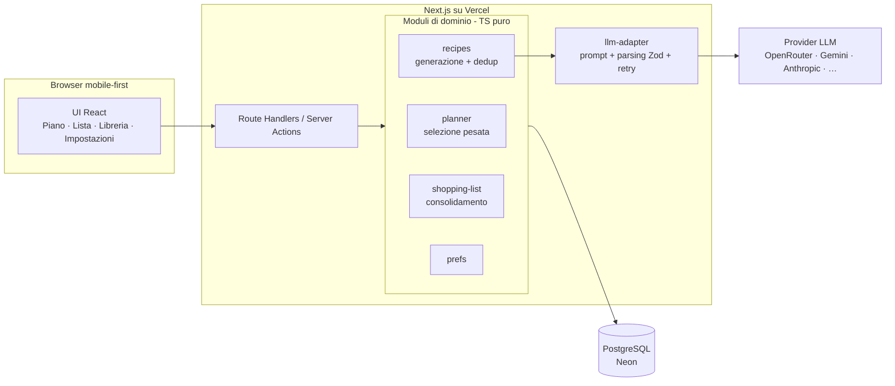

# Cosa Mangio Oggi — Documento di Architettura

**Versione:** 1.0 — 13 luglio 2026
**Stato:** Proposta
**Ambito:** applicazione personale (single user, predisposta per uso condiviso futuro)

---

## 1. Contesto e obiettivi

App web personale di meal planning che risponde alla domanda "cosa mangio oggi?". Genera un piano settimanale di ricette (pranzo e/o cena) rispettando i vincoli del nucleo domestico, produce la lista della spesa consolidata e spuntabile, e apprende le preferenze dell'utente per privilegiare certe ricette rispetto ad altre.

### 1.1 Obiettivi v1

- Piano settimanale pranzo/cena generato automaticamente da una **libreria di ricette persistente**
- Sostituzione della singola ricetta di uno slot ("non mi piace, cambiala")
- Sistema di **preferenze esplicite** (rating 1–5, preferita, bloccata) che pesa la selezione
- **Lista della spesa** consolidata, raggruppata per reparto, spuntabile, con persistenza della spunta
- Vincoli globali configurabili: numero persone, pasti da pianificare (pranzo/cena/entrambi), tipo pasti (veloce, salutare, proteico, poche calorie, …), esigenze alimentari (vegetariano, vegano, intolleranze), elettrodomestici disponibili

### 1.2 Non-obiettivi v1

- Nessuna selezione supermercato, nessun prezzo, nessun budget
- Nessuna autenticazione multiutente (l'app è usata da una sola persona; lo schema è però predisposto per l'uso condiviso in due — vedi §9)
- Nessun calcolo nutrizionale certificato: calorie/macro sono indicative (generate da LLM), non hanno valore clinico
- Nessuna app nativa: web mobile-first (la lista della spesa si usa dal telefono al supermercato)

### 1.3 Principio guida

> **Le ricette generate non sono usa-e-getta: sono la libreria.** Il piano settimanale è una *selezione pesata* dalla libreria, non una generazione da zero. L'LLM interviene solo per popolare la libreria quando il pool di candidate è insufficiente. Questo rende possibili le preferenze, abbatte i costi LLM e rende il piano deterministico e testabile.

---

## 2. Stack

| Livello | Scelta | Motivazione |
|---|---|---|
| Framework | Next.js (App Router, TypeScript) | Full-stack in un repo, stesso stack di CashFlow Casa, deploy Vercel nativo |
| UI | Tailwind CSS + shadcn/ui | Velocità, componenti accessibili, vedi `DESIGN.md` |
| Database | PostgreSQL | Relazionale è il fit naturale (ricette↔piani↔preferenze), familiarità |
| ORM | Drizzle ORM + drizzle-kit (migrazioni) | Type-safe, leggero, SQL-first, driver serverless Neon supportato |
| Validazione | Zod | Contratto unico per input API e output LLM |
| LLM | Vercel AI SDK (`generateObject` + Zod) con provider intercambiabile via env | Provider-agnostico: OpenRouter (anche modelli gratuiti), Gemini, Anthropic, … — si cambia con due variabili d'ambiente |
| Deploy | Vercel + Neon Postgres (Opzione A, §8) | Free tier sufficiente, zero ops |

---

## 3. Architettura ad alto livello

Monolite Next.js full-stack. Nessun servizio separato: la logica di dominio vive in moduli TypeScript puri (testabili in isolamento), esposti tramite Route Handlers / Server Actions.



Regole di dipendenza:

1. `planner`, `shopping-list`, `prefs` sono **funzioni pure + repository**: nessuna chiamata LLM al loro interno. Solo `recipes` parla con `llm-adapter`.
2. `llm-adapter` è l'unico punto che conosce il provider: prompt, schema di output, retry/repair. Il provider concreto è **configurazione, non codice**: si seleziona con `LLM_PROVIDER` + `LLM_MODEL` (vedi §7); cambiare provider non tocca nessun altro modulo.
3. Le entità condivise (tipi `Recipe`, `Ingredient`, enum unità/reparti/tag) vivono in `lib/domain/types.ts` e sono derivate dagli schemi Zod (single source of truth).

---

## 4. Modello dati

### 4.1 Decisione chiave: ingredienti normalizzati alla fonte

Il consolidamento della lista della spesa (sommare "200 g di petto di pollo" + "150 g di petto di pollo" tra ricette diverse) è deterministico **solo se gli ingredienti nascono già normalizzati**. Quindi il contratto di generazione LLM impone:

- `canonical_name`: minuscolo, singolare, senza aggettivi di preparazione ("petto di pollo", non "Petti di pollo tagliati a cubetti" — la preparazione va nei passi della ricetta)
- `unit`: enum chiuso → `g | ml | pz | qb` (l'LLM converte: kg→g, l→ml, "2 spicchi"→pz con nota; `qb` = quanto basta, senza quantità)
- `category`: enum chiuso dei reparti → `ortofrutta | macelleria | pescheria | banco-frigo | dispensa | surgelati | pane | bevande | altro`

La tabella `ingredient_aliases` assorbe nel tempo i sinonimi residui ("pomodori pelati" ≡ "pelati").

### 4.2 Schema (Drizzle → Postgres)

```
households                 -- singleton in v1, chiave di partizione futura
  id, persons int, meals text[] ('pranzo','cena'),
  diet_tags text[], meal_style_tags text[], appliances text[],
  created_at, updated_at

recipes
  id, household_id FK,
  title text, slug text unique,
  description text, steps jsonb (string[]),
  meal_types text[] ('pranzo','cena'),
  tags text[] (veloce, salutare, proteico, ...),
  diet_flags text[] (vegetariano, vegano, senza-glutine, ...),
  appliances_required text[],
  servings_base int, prep_minutes int,
  kcal_est int null, macros_est jsonb null,
  source text ('llm','manual'), created_at

recipe_ingredients
  id, recipe_id FK,
  canonical_name text, display_name text,
  qty numeric null, unit text ('g','ml','pz','qb'),
  category text (enum reparti),
  note text null

recipe_prefs               -- 1:1 con recipes in v1; PK (recipe_id) → (recipe_id, user_id) in v2
  recipe_id FK PK,
  rating int null (1..5), favorite bool default false, blocked bool default false,
  times_used int default 0, last_used_at timestamptz null

meal_plans
  id, household_id FK, week_start date, status ('draft','active','archived'),
  created_at
  unique (household_id, week_start)

plan_slots
  id, plan_id FK, day date, meal text ('pranzo','cena'),
  recipe_id FK, servings int,
  locked bool default false      -- lo slot bloccato sopravvive alla rigenerazione del piano
  unique (plan_id, day, meal)

shopping_lists             -- 1:1 con meal_plans
  id, plan_id FK unique, generated_at

shopping_items
  id, list_id FK,
  canonical_name text, qty numeric null, unit text, category text,
  checked bool default false, manual bool default false,  -- item aggiunti a mano
  recipe_ids uuid[]          -- tracciabilità: da quali ricette proviene

ingredient_aliases
  alias text PK, canonical_name text

ingredient_prefs           -- popolata lazy: solo gli ingredienti su cui si è espresso un giudizio
  canonical_name text PK,
  pref text ('like','dislike'),
  created_at
```

Indici principali: `recipes(household_id)`, GIN su `recipes.tags/diet_flags`, `pg_trgm` su `recipes.title` per il dedup, `shopping_items(list_id, category)`.

---

## 5. Logiche core

### 5.1 Generazione ricette (LLM)

Input: vincoli household + `meal_type` + numero di ricette richieste + lista titoli già in libreria (per evitare duplicati) + ingredienti `like` ("privilegia quando sensato") e `dislike` ("non usare mai").

Contratto di output (Zod, schema JSON stretto):

```jsonc
{
  "recipes": [{
    "title": "…",
    "description": "…",
    "meal_types": ["cena"],
    "tags": ["veloce", "proteico"],
    "diet_flags": ["vegetariano"],
    "appliances_required": ["fornelli"],
    "servings_base": 2,
    "prep_minutes": 25,
    "kcal_est": 520,
    "steps": ["…", "…"],
    "ingredients": [
      { "canonical_name": "petto di pollo", "display_name": "petto di pollo a cubetti",
        "qty": 300, "unit": "g", "category": "macelleria" }
    ]
  }]
}
```

Pipeline: prompt → parse Zod → **se fallisce, 1 retry di "repair"** (si rimanda l'errore di validazione al modello) → dedup contro la libreria (titolo normalizzato + similarità `pg_trgm` > 0.6 ⇒ scarta) → insert transazionale ricetta+ingredienti+pref di default.

Costi: un batch da 5 ricette ≈ pochi migliaia di token ⇒ centesimi. A regime la libreria copre quasi tutto e l'LLM si chiama di rado.

### 5.2 Selezione pesata per il piano settimanale

Per ogni slot da riempire, il pool di candidate è filtrato per vincoli **duri** (esclusioni), poi campionato con peso (weighted random senza reinserimento nella settimana).

Esclusioni (hard):
- `blocked = true`
- `meal_type` non compatibile con lo slot
- `diet_flags` che non soddisfano le esigenze household
- `appliances_required` ⊄ elettrodomestici disponibili
- contiene almeno un ingrediente con pref `dislike`
- già selezionata in questa settimana (max 1 occorrenza per piano)

Peso (soft):

```
peso(r) = ratingFactor × favoriteBoost × recencyDecay × noveltyBonus × ingredientAffinity

ratingFactor  = 1                       se rating assente
              = 0.25 + rating / 4       → 0.5 … 1.5
favoriteBoost = 1.5 se favorite, altrimenti 1
recencyDecay  = 0                        se last_used_at < 10 giorni fa
              = lineare 0 → 1            tra 10 e 28 giorni
              = 1                        oltre 28 giorni o mai usata
noveltyBonus  = 1.2 se times_used = 0    (fa ruotare le ricette nuove)
ingredientAffinity = 1 + 0.15 × min(2, n° ingredienti con pref like)   → 1 … 1.3
```

Se il pool valido per uno slot è `< soglia` (default 3), il planner chiede a `recipes` di generare nuove ricette per quel `meal_type` con i vincoli correnti, poi riprova. Alla conferma del piano si aggiornano `times_used` e `last_used_at`.

I parametri (10/28 giorni, boost, soglia) sono costanti in `lib/domain/planner-config.ts`: tarabili senza toccare la logica.

### 5.3 Swap di uno slot

Stesso algoritmo di 5.2 applicato al singolo slot, con exclude-list = ricetta attuale + tutte le altre del piano. Lo swap invalida la lista della spesa se già generata (flag "lista da rigenerare" sulla UI, rigenerazione esplicita che preserva le spunte per `canonical_name` dove possibile).

### 5.4 Preferenze

Solo segnali espliciti in v1, su **due livelli**: la **ricetta** (rating 1–5, preferita, bloccata) e il **singolo ingrediente** (like/dislike su `canonical_name`). Le preferenze ingrediente si popolano man mano dalle ricette proposte — nessuna anagrafica ingredienti da riempire a priori: la chiave `canonical_name` esiste già grazie alla normalizzazione di §4.1. Un `dislike` è un filtro duro (esclude dalla selezione e dalla generazione LLM); un `like` è un boost morbido. Poiché scartare un ingrediente molto comune (es. cipolla) può escludere una fetta ampia di libreria, la UI mostra l'impatto prima di confermare ("escluderà N ricette"). `times_used`/`last_used_at` si aggiornano automaticamente alla conferma del piano e alimentano recency e novelty. Nessun machine learning: la formula di 5.2 è trasparente e spiegabile ("perché mi hai proposto questa?" ha una risposta leggibile).

### 5.5 Consolidamento lista della spesa

Funzione pura `buildShoppingList(slots, recipes) → items`:

1. **Scala** le quantità di ogni ricetta: `qty × servings_slot / servings_base`
2. **Aggrega** per chiave `(canonical_name, unit)` sommando le quantità; gli item `qb` si uniscono senza quantità; risolve gli alias via `ingredient_aliases`
3. **Arrotonda** a quantità sensate (g → multipli di 10; pz → intero superiore)
4. **Raggruppa** per `category` nell'ordine tipico del giro al supermercato: ortofrutta → pane → macelleria → pescheria → banco-frigo → dispensa → surgelati → bevande → altro
5. Mantiene `recipe_ids` per item (tap sull'item → "serve per: X, Y")

Casi limite accettati in v1: unità eterogenee per lo stesso ingrediente (es. "pz" e "g" di limone) restano su due righe; la tabella alias riduce il fenomeno nel tempo.

---

## 6. Superficie API

Route Handlers sotto `/api` (o Server Actions equivalenti — scelta implementativa per story):

| Metodo | Rotta | Funzione |
|---|---|---|
| GET/PUT | `/api/settings` | Vincoli household |
| GET | `/api/recipes?filter…` | Libreria con filtri/ricerca |
| POST | `/api/recipes/generate` | Genera N ricette via LLM e le salva |
| GET | `/api/recipes/:id` | Dettaglio |
| PUT | `/api/recipes/:id/pref` | Rating / preferita / bloccata |
| GET | `/api/ingredient-prefs` | Elenco like/dislike sugli ingredienti |
| PUT | `/api/ingredient-prefs/:canonicalName` | Imposta o rimuove like/dislike (con conteggio ricette impattate) |
| POST | `/api/plans` | Genera piano per `week_start` |
| GET | `/api/plans/current` | Piano attivo |
| POST | `/api/plans/:id/slots/:slotId/swap` | Sostituisce la ricetta dello slot |
| POST | `/api/plans/:id/confirm` | Conferma piano (aggiorna prefs usage) |
| POST | `/api/plans/:id/shopping-list` | (Ri)genera lista |
| GET | `/api/plans/:id/shopping-list` | Lista raggruppata |
| PATCH | `/api/shopping-items/:id` | Spunta / modifica / aggiunta manuale |

Tutte le request/response validate con gli stessi schemi Zod del dominio.

---

## 7. LLM: resilienza e costi

- **Adapter unico** (`lib/llm/`): firma `generateRecipes(constraints, n, excludeTitles) → Recipe[]`; il provider è un dettaglio interno
- **Provider-agnostico via Vercel AI SDK**: `generateObject` con lo stesso schema Zod del contratto §5.1; una factory `getModel()` legge `LLM_PROVIDER` (`openrouter | google | anthropic`) e `LLM_MODEL` dall'env e istanzia il pacchetto corrispondente (`@openrouter/ai-sdk-provider`, `@ai-sdk/google`, `@ai-sdk/anthropic`). Cambiare provider o modello = cambiare due variabili d'ambiente. Piano B se un provider non ha il pacchetto AI SDK: quasi tutti (OpenRouter e Gemini inclusi) espongono un endpoint OpenAI-compatibile, quindi basta il provider `openai-compatible` con `baseURL` configurabile
- **Modelli gratuiti/economici**: con i modelli free di OpenRouter o il free tier di Gemini la qualità del JSON strutturato varia molto da modello a modello → il retry di repair (§5.1) non è un'ottimizzazione ma un requisito; preferire modelli che dichiarano supporto a JSON/tool mode e considerare che i free tier hanno rate limit propri (la generazione batch da 5 ricette li rispetta facilmente)
- **Output strutturato**: parse Zod, 1 retry con messaggio di repair, poi errore applicativo gestito in UI ("riprova")
- **Timeout**: la generazione può richiedere 10–30 s → la UI mostra stato di progresso (vedi `DESIGN.md`); su Vercel usare route con `maxDuration` adeguata
- **Dedup**: titolo normalizzato + `pg_trgm`; l'exclude-list dei titoli è nel prompt
- **Chiavi API**: una variabile server-side per provider (`OPENROUTER_API_KEY`, `GOOGLE_GENERATIVE_AI_API_KEY`, `ANTHROPIC_API_KEY`), mai esposte al client; serve solo quella del provider attivo

---

## 8. Deployment — mini-ADR

**Decisione: Opzione A (Vercel + Neon).** Schema e ORM restano Postgres standard, quindi migrare all'Opzione C è un `pg_dump`/`pg_restore`.

### Opzione A — Vercel + Neon Postgres ✅ scelta

| Dimensione | Valutazione |
|---|---|
| Costo | 0 € (free tier: ~0,5 GB storage, 100 CU-ore/mese, ampiamente sufficienti: le ricette sono testo) |
| Ops | Zero: scale-to-zero automatico con resume rapido alla prima query |
| Integrazione | Nativa con Vercel (Neon è il Postgres di riferimento dell'ecosistema Vercel), driver serverless senza problemi di connection pooling |
| Rischi | Cold start di qualche centinaio di ms dopo idle — irrilevante per uso personale |

### Opzione B — Vercel + Supabase (scartata per v1)

Pro: auth integrata, utile per il futuro scenario "in due". Contro decisivo: **il free tier mette in pausa il progetto dopo ~7 giorni di inattività**, con riattivazione manuale dalla dashboard — pessimo per un'app usata a cadenza settimanale; il piano Pro (25 $/mese) non è giustificato. Se in v2 servirà auth, meglio Auth.js/Clerk sopra Neon.

### Opzione C — Self-host su Raspberry Pi (piano B documentato)

Docker Compose: `next` (build standalone) + `postgres` + volume dati + `cron` di backup (`pg_dump` giornaliero). Accesso da fuori casa via **Tailscale** (niente esposizione pubblica, niente certificati da gestire). Più controllo e nessun vincolo di piattaforma, al prezzo di ops (aggiornamenti, backup, SD/SSD affidabile).

**Anti-pattern esplicito**: app su Vercel + Postgres sul Raspberry di casa (DB esposto a internet o raggiungibile solo in LAN, latenza, fragilità). O tutto su Vercel+Neon, o tutto sul Raspberry.

---

## 9. Evoluzioni previste (fuori scope v1, ma lo schema le prevede)

- **Uso in due, tutto condiviso**: si aggiunge `users` + auth (Auth.js); `households` diventa il perimetro condiviso già presente; le preferenze restano condivise (un solo `recipe_prefs`) come richiesto — l'eventuale split per utente è `PK (recipe_id, user_id)`
- **PWA / offline** per la lista della spesa al supermercato (cache + sync spunte)
- Ricette manuali (inserimento/import) accanto a quelle generate
- Export/stampa del piano e della lista

## 10. Cosa rivedere se il sistema cresce

Con più utenti reali: rate-limit sulla generazione LLM, coda per i batch di generazione, revisione della formula di peso con segnali impliciti (skip/swap come feedback negativo), e migrazione della lista spesa a sync in tempo reale se condivisa tra due telefoni.
