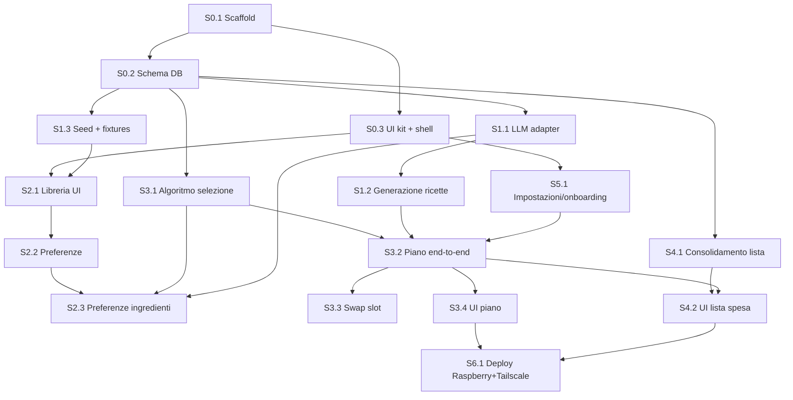

# Cosa Mangio Oggi — Backlog di sviluppo

> **Esecuzione**: la v1 si sviluppa con la pipeline `agentic-feature-factory` (feature = epic, ordine **E0 → E1 → E5 → E3 → E2 → E4 → E6**). Mappatura, motivazioni e dettaglio per feature: [`planning/execution-strategy.md`](planning/execution-strategy.md) · stato: [`planning/feature-index.md`](planning/feature-index.md). Questo documento resta la fonte di story e criteri di accettazione.

Diviso in **epic → story → task**. Ogni story è pensata per essere consegnata così com'è a una sessione di sviluppo (o a Claude Code) e chiusa in autonomia: ha obiettivo, task e criteri di accettazione. Le dipendenze sono esplicite per permettere la parallelizzazione.

## Grafo delle dipendenze e binari paralleli

Dopo il fondamento (E0), si lavora su **tre binari indipendenti**:

| Binario | Story | Nota |
|---|---|---|
| A — Motore (backend) | S1.1 → S1.2, S1.3 | Nessuna UI necessaria |
| B — UI (frontend) | S5.1, S2.1 → S2.2 → S2.3 | Lavora su **fixtures** (S1.3), non aspetta l'LLM |
| C — Logica pura | S3.1, S4.1 | Funzioni pure + test, sviluppabili su fixtures da subito |

I punti di giunzione sono S3.2 (motore+UI+impostazioni) e S4.2 (lista reale sul piano reale).

Stima ordini di grandezza: E0+un binario = un weekend; v1 completa (E0–E6) = 3–4 weekend.

---

## E0 — Fondamenta

### S0.1 Scaffold del progetto ⚑ blocca tutto
Obiettivo: repo pronto per lavorare in parallelo.
- [ ] `create-next-app` (App Router, TS, Tailwind), ESLint + Prettier
- [ ] shadcn/ui inizializzato; token colore/font da `DESIGN.md` in `tailwind.config` + `next/font` (Fraunces, Figtree)
- [ ] Struttura cartelle: `app/`, `lib/domain/`, `lib/llm/`, `lib/db/`, `fixtures/`
- [ ] Vitest configurato; script `dev`, `test`, `db:*` in package.json; `.env.example`

Accettazione: `pnpm dev` parte, `pnpm test` verde, un componente shadcn renderizza con i token del design.

### S0.2 Schema DB e migrazioni — dipende da S0.1
Obiettivo: schema di `ARCHITECTURE.md §4.2` in Drizzle, migrabile.
- [ ] Tabelle: households, recipes, recipe_ingredients, recipe_prefs, meal_plans, plan_slots, shopping_lists, shopping_items, ingredient_aliases
- [ ] Enum/const condivisi in `lib/domain/types.ts` derivati da Zod (unità, reparti, tag, diete, elettrodomestici)
- [ ] Migrazioni drizzle-kit; Postgres locale via `docker-compose.dev.yml`
- [ ] Indici: GIN su tags/diet_flags, `pg_trgm` su recipes.title

Accettazione: `pnpm db:migrate` crea lo schema da zero; insert/select di una ricetta con ingredienti via repository tipato.

### S0.3 UI kit e shell di navigazione — dipende da S0.1 ∥ parallela a S0.2
Obiettivo: scheletro navigabile delle 4 tab.
- [ ] Tab bar inferiore (Piano · Lista · Libreria · Impostazioni) con route App Router
- [ ] Componenti base: MealCard, RecipeSheet (vaso vuoto), ShoppingItemRow, ChipFilter, EmptyState — con dati finti hardcoded
- [ ] Layout mobile-first + variante desktop a colonne

Accettazione: si naviga tra le 4 tab su mobile; MealCard e ShoppingItemRow corrispondono a `DESIGN.md` (tap target, palette, swap button visibile).

---

## E1 — Motore ricette (Binario A)

### S1.1 LLM adapter — dipende da S0.2
Obiettivo: unico modulo che parla col provider LLM, **provider-agnostico** (Vercel AI SDK).
- [ ] `lib/llm/adapter.ts`: `generateRecipes(constraints, n, excludeTitles)` basata su `generateObject` + schema Zod
- [ ] Factory `getModel()` da env `LLM_PROVIDER` + `LLM_MODEL`; provider al lancio: OpenRouter, Google Gemini, Anthropic (+ fallback `openai-compatible` con `baseURL`)
- [ ] Prompt in italiano con vincoli (dieta, elettrodomestici, tipo pasto, persone) e contratto JSON di `ARCHITECTURE.md §5.1`
- [ ] Parse Zod dell'output + 1 retry di repair con l'errore di validazione
- [ ] Test con risposte LLM registrate (nessuna chiamata reale nei test)

Accettazione: input vincoli → array `Recipe[]` valido o errore tipizzato; il retry ripara un JSON volutamente malformato nei test; si cambia provider/modello toccando solo l'env (smoke test manuale su almeno due provider, es. un free di OpenRouter e Gemini).

### S1.2 Generazione e persistenza ricette — dipende da S1.1
Obiettivo: dal prompt alla libreria.
- [ ] `POST /api/recipes/generate`: chiama adapter, dedup (titolo normalizzato + pg_trgm > 0.6), insert transazionale ricetta+ingredienti+pref default
- [ ] Gestione timeout/route `maxDuration`; errori applicativi puliti per la UI

Accettazione: due chiamate consecutive non producono duplicati; le ricette rispettano i vincoli passati (test manuale con vincoli estremi: "solo friggitrice ad aria, vegano").

### S1.3 Seed e fixtures — dipende da S0.2 ∥ parallela a S1.1
Obiettivo: sbloccare i binari B e C senza LLM.
- [ ] `fixtures/recipes.json`: 15–20 ricette realistiche conformi allo schema (varie per pasto, dieta, elettrodomestici)
- [ ] Script `pnpm db:seed` idempotente
- [ ] Seed di `ingredient_aliases` con i sinonimi ovvi

Accettazione: DB seedato → la Libreria (S2.1) e i test di S3.1/S4.1 girano senza chiavi API.

---

## E2 — Libreria e preferenze (Binario B)

### S2.1 Libreria UI — dipende da S0.3 + S1.3
- [ ] `GET /api/recipes` con filtri (pasto, tag, dieta, preferite) e ricerca
- [ ] Griglia card + RecipeSheet completo (ingredienti scalati sulle persone household, passi)
- [ ] Stati vuoto/caricamento da `DESIGN.md §5`

Accettazione: filtro e ricerca funzionano sul seed; il dettaglio mostra quantità scalate.

### S2.2 Preferenze — dipende da S2.1
- [ ] `PUT /api/recipes/:id/pref` (rating, favorite, blocked)
- [ ] Controlli nel RecipeSheet e ★ rapida sulla card; le bloccate spariscono dalle proposte e restano visibili in Libreria con filtro dedicato

Accettazione: rating/star/block persistono al reload; una ricetta bloccata non è mai proposta dal planner (test d'integrazione con S3.1 quando disponibile).

### S2.3 Preferenze ingredienti — dipende da S2.2 + S3.1 + S1.1
Obiettivo: like/dislike sul singolo ingrediente, popolati man mano dalle ricette proposte (nessuna anagrafica ingredienti a priori; chiave = `canonical_name`).
- [ ] Tabella `ingredient_prefs (canonical_name PK, pref like|dislike)` + migrazione
- [ ] `GET /api/ingredient-prefs`, `PUT /api/ingredient-prefs/:canonicalName` (set/rimuovi; la PUT risponde col conteggio ricette impattate)
- [ ] UI: toggle 👍/👎 sulle righe ingrediente del RecipeSheet; conferma con impatto allo scarto ("Escluderà N ricette"); sezione *I miei ingredienti* nelle Impostazioni
- [ ] Planner: `dislike` = esclusione hard (estensione filtri S3.1), `like` = fattore `ingredientAffinity` nella formula peso
- [ ] LLM: liste like/dislike nel prompt ("privilegia quando sensato" / "non usare mai")
- [ ] Test: esclusione per dislike, boost statistico per like (estensione suite S3.1); prompt che rispetta i dislike (fixture registrate S1.1)

Accettazione: scartato un ingrediente, nessuna ricetta che lo contiene viene più né proposta né generata; con like attivi, le ricette che li contengono escono con frequenza maggiore nel test statistico.

---

## E3 — Pianificatore

### S3.1 Algoritmo di selezione pesata — dipende da S0.2 (∥ Binari A e B)
Obiettivo: cuore del prodotto come **funzione pura testata**.
- [ ] `lib/domain/planner.ts`: filtri hard + formula peso di `ARCHITECTURE.md §5.2`, campionamento pesato senza ripetizioni, seedable RNG per test deterministici
- [ ] Config in `planner-config.ts`
- [ ] Test: esclusioni (blocked, dieta, elettrodomestici), recency, boost preferite, max 1 occorrenza/settimana, pool insufficiente → richiesta `needMore`

Accettazione: suite verde; con RNG seedato l'output è riproducibile; su 1000 estrazioni le preferite escono con frequenza ~1.5×.

### S3.2 Generazione piano end-to-end — dipende da S3.1 + S1.2 + S5.1
- [ ] `POST /api/plans`: crea piano per la settimana, riempie gli slot, invoca generazione LLM se `needMore`
- [ ] `POST /api/plans/:id/confirm`: aggiorna times_used/last_used_at
- [ ] Rigenerazione piano che rispetta gli slot `locked`

Accettazione: da DB quasi vuoto, una chiamata produce un piano completo (con generazione automatica); da libreria ricca, zero chiamate LLM.

### S3.3 Swap slot — dipende da S3.2
- [ ] `POST /api/plans/:id/slots/:slotId/swap` con exclude-list (attuale + resto del piano)
- [ ] Se la lista spesa esiste → flag "da rigenerare"

Accettazione: swap ripetuti non ripropongono mai la stessa ricetta nella settimana.

### S3.4 UI Piano — dipende da S3.2 (∥ S3.3)
- [ ] Home con card-pasto per giorno, CTA Genera/Rigenera, lock con long-press
- [ ] Animazione swap (flip → Tieni/Cambia ancora), reduced-motion → dissolvenza
- [ ] Stato generazione con microcopy a rotazione

Accettazione: flusso completo da telefono: genera → sfoglia → swap → conferma.

---

## E4 — Lista della spesa (Binario C per la logica)

### S4.1 Consolidamento — dipende da S0.2 (∥ tutto il resto)
Obiettivo: `buildShoppingList` come **funzione pura testata** (ARCHITECTURE §5.5).
- [ ] Scala per porzioni, aggrega per (canonical_name, unit), risolve alias, arrotonda, ordina per reparto
- [ ] Test: somma tra ricette, qb, unità eterogenee su righe separate, tracciabilità recipe_ids

Accettazione: suite verde su fixtures; nessun accesso a rete/LLM.

### S4.2 UI Lista spesa — dipende da S4.1 + S3.2
- [ ] `POST/GET /api/plans/:id/shopping-list`, `PATCH /api/shopping-items/:id`
- [ ] Sezioni per reparto, riga intera come target di spunta, spuntati in fondo, progress per sezione
- [ ] Item manuali (FAB); rigenerazione che preserva le spunte per canonical_name; spunta optimistic

Accettazione: uso reale al supermercato: spunte immediate anche con rete lenta, stato preservato al ritorno dall'app in background.

---

## E5 — Impostazioni

### S5.1 Onboarding e impostazioni — dipende da S0.3 (∥ Binario A)
- [ ] `GET/PUT /api/settings` su `households`
- [ ] Wizard a step al primo avvio (persone → pasti → tipo pasti → esigenze → elettrodomestici), form unico dopo
- [ ] Modifica vincoli → banner "il prossimo piano userà i nuovi vincoli" (nessuna rigenerazione retroattiva)

Accettazione: primo avvio forza il wizard; i vincoli arrivano al planner e all'LLM.

---

## E6 — Deploy

### S6.1 Self-host su Raspberry Pi (Docker Compose + Tailscale) — dipende da S3.4 + S4.2
- [ ] Dockerfile multi-stage (`output: 'standalone'`) compatibile ARM64/AMD64
- [ ] `docker-compose.prod.yml`: Next.js + Postgres 16 + volume persistente dati + `cron` di backup (`pg_dump` giornaliero con retention 7gg)
- [ ] Script di migrazione automatica Drizzle all'avvio e smoke test
- [ ] Configurazione env di produzione (`DATABASE_URL`, `LLM_PROVIDER`, `LLM_MODEL`, chiavi API)
- [ ] Setup e doc accesso via Tailscale (MagicDNS / IP privato per accesso sicuro da smartphone al supermercato)

Accettazione: flusso completo in produzione dal telefono tramite Tailscale.

### S6.2 (Alternativa) Vercel + Neon — opzionale se si migra al cloud pubblico in v2
- [ ] Progetto Vercel + integrazione Neon; env (DATABASE_URL, LLM_PROVIDER, LLM_MODEL + chiave API del provider attivo)
- [ ] Richiede introduzione di un layer di autenticazione/password gate per proteggere le quote LLM
- [ ] Migrazioni in CI/CD (drizzle-kit al deploy); `maxDuration` sulle route di generazione

---

## Ordine consigliato (solista, weekend)

1. **W1**: S0.1 → S0.2 + S0.3 → S1.3 → S3.1 e S4.1 (logica pura su fixtures)
2. **W2**: S1.1 → S1.2 in parallelo a S5.1 + S2.1
3. **W3**: S3.2 → S3.4 + S3.3, poi S2.2 e S2.3
4. **W4**: S4.2 → S6.1 → rifiniture da uso reale
