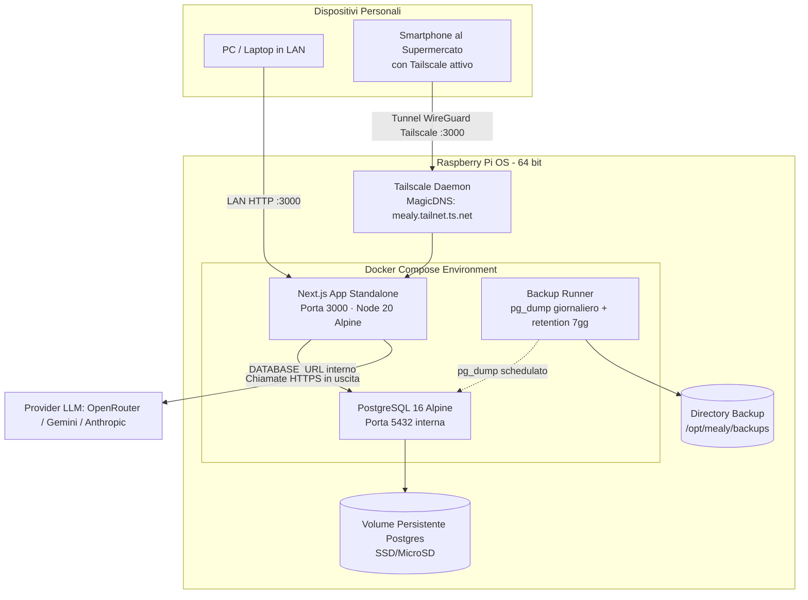

# Feature 7 — E6 Deploy: Self-Hosting su Raspberry Pi (Docker Compose + Tailscale)

## 1. Overview & Problem Statement

Mealy è un'applicazione web personale di meal planning per uso quotidiano (pianificazione pasti, archivio ricette, preferenze, generazione lista della spesa).
Nelle specifiche iniziali di v1, l'applicazione è progettata come **single-user senza autenticazione applicativa** (il modello dati prevede un `household` di default, ma nessuna tabella `users` né sistema di login).

Se distribuita su una piattaforma cloud pubblica come Vercel:
- L'applicazione e i relativi endpoint API (tra cui la generazione di ricette via LLM esterno: OpenRouter, Gemini, Anthropic) risulterebbero accessibili pubblicamente da chiunque trovi l'URL (inclusi web crawler e bot).
- Senza un sistema di autenticazione applicativa (o il piano Vercel Pro con password protection a pagamento), ciò comporterebbe gravi rischi di privacy e potenziale esaurimento dei crediti API LLM per traffico non autorizzato.
- Introdurre un sistema completo di login/autenticazione (Auth.js/Clerk) nella v1 violerebbe il principio YAGNI, appesantendo la codebase prima ancora di aver validato il core domain.

**Obiettivo:** Realizzare il deployment della v1 di Mealy su un server domestico **Raspberry Pi** tramite **Docker Compose**, proteggendo l'accesso da remoto (incluso l'uso dello smartphone al supermercato per spuntare la lista della spesa) tramite la VPN mesh privata **Tailscale**, mantenendo l'applicazione a zero complessità di autenticazione e zero costi fissi.

---

## 2. Decisions & Rationale

### Decisione 1: Target di Hosting — Raspberry Pi (Opzione C di ARCHITECTURE §8) anziché Vercel (Opzione A)
- **Motivazione:** Il Raspberry Pi è sempre acceso nella rete domestica. Ospita sia l'applicazione Next.js sia il database PostgreSQL in container Docker.
- **Vantaggi:**
  1. *Sicurezza e Privacy:* Nessuna esposizione diretta su Internet, nessuna porta aperta sul router di casa (no port forwarding).
  2. *Zero costi ricorrenti:* Nessuna dipendenza da piani a consumo o limitazioni di free tier di Neon (cold start) o Vercel (limiti di timeout serverless a 10-60s per chiamate LLM).
  3. *Parità d'ambiente:* Postgres locale in Docker identico all'ambiente di sviluppo (`docker-compose.dev.yml`), con backup `pg_dump` automatici su storage locale/NAS.

### Decisione 2: Sicurezza e Accesso da Remoto — Rete Mesh Tailscale (Zero Trust Network)
- **Motivazione:** Permette di accedere a Mealy sia dal PC di casa (via LAN/mDNS) sia dallo smartphone mentre si è al supermercato senza esporre porte pubbliche su Internet.
- **Meccanismo:** Con Tailscale attivo sul Raspberry Pi e sui dispositivi personali autorizzati, Mealy è raggiungibile all'IP privato Tailscale o al nome MagicDNS (es. `http://mealy.<tailnet-name>.ts.net:3000`).
- **YAGNI sull'Autenticazione:** Nessuna riga di codice di login, nessun cookie di sessione, nessuna gestione password nell'app. L'autenticazione è demandata interamente alla sicurezza di rete crittografata di Tailscale.

### Decisione 3: Build & Packaging — Docker Multi-Stage con Next.js Standalone
- **Motivazione:** Next.js supporta la modalità `output: 'standalone'`, che isola esclusivamente i file necessari per l'esecuzione in produzione in una cartella minimalista.
- **Target Architettura:** Supporto nativo multi-arch (`linux/arm64` per Raspberry Pi 4/5, compatibile anche con `linux/amd64` per test locali su PC).

---

## 3. Functional Requirements

1. **FR-1: Esecuzione autonoma e continua (Always-on)**
   - L'applicazione Next.js e il database PostgreSQL devono avviarsi automaticamente all'avvio del Raspberry Pi (`restart: unless-stopped`).
   - In caso di crash di un processo o riavvio del Raspberry Pi, i servizi devono ripristinarsi in modo trasparente senza interventi manuali.

2. **FR-2: Persistenza dei dati e migrazioni automatiche**
   - Tutti i dati di PostgreSQL (database `mealy`, ricette, piani, preferenze, lista spesa) devono essere persistiti in un volume Docker dedicato o percorso su disco host (microSD o SSD USB).
   - All'avvio dell'aggiornamento dell'applicazione, le migrazioni Drizzle devono essere eseguite automaticamente e in modo idempotente prima dell'accettazione del traffico.

3. **FR-3: Backup automatico del database**
   - Un servizio o job pianificato deve effettuare quotidianamente un dump (`pg_dump`) del database PostgreSQL.
   - I backup devono essere conservati in una directory host con rotazione temporale automatica (mantenimento degli ultimi 7 dump giornalieri).

4. **FR-4: Accessibilità in LAN e da remoto via Tailscale**
   - **Accesso in casa:** `http://<ip-lan-raspberry>:3000` o `http://raspberrypi.local:3000`.
   - **Accesso fuori casa (Supermercato):** `http://mealy.<tailnet>.ts.net:3000` o `http://100.x.y.z:3000` con app Tailscale attiva sullo smartphone.
   - Tutti i flussi applicativi (spunta lista della spesa, rigenerazione slot, navigazione ricette) devono funzionare con tempi di risposta reattivi anche su connessione dati mobile 4G/5G attraverso il tunnel Tailscale.

5. **FR-5: Procedura di aggiornamento (Deploy / Update)**
   - Deve essere fornito uno script riutilizzabile (es. `deploy.sh` o workflow documentato) che con un singolo comando:
     1. Effettui il pull del codice aggiornato dal repository git.
     2. Esegua la build / riavvio dei container con `docker compose`.
     3. Applichi le nuove migrazioni DB.
     4. Esegua un healthcheck di smoke test confermando che l'app risponde HTTP 200.

---

## 4. Architectural & Technical Design

### 4.1 Componenti del deployment

### 4.2 File e configurazioni da introdurre

1. **`Dockerfile` (Root del repo)**:
   - Multi-stage build (`deps` → `builder` → `runner`).
   - Base `node:20-alpine`.
   - In `next.config.js`: abilitare `output: 'standalone'`.
   - Immagine runner leggera (solo `standalone` e cartelle `public` + `.next/static`), eseguita con utente non-root `nextjs`.

2. **`docker-compose.prod.yml`**:
   - `services.app`:
     - build dal `Dockerfile`.
     - ports: `"3000:3000"`.
     - environment da file `.env.production`.
     - depends_on: `db` con condizione di healthcheck (`pg_isready`).
     - restart: `unless-stopped`.
   - `services.db`:
     - image: `postgres:16-alpine`.
     - volumes: `postgres_data:/var/lib/postgresql/data`.
     - healthcheck: `pg_isready -U mealy -d mealy`.
     - restart: `unless-stopped`.
   - `services.backup`:
     - container leggero con `cron` e `postgresql-client` che esegue `pg_dump` ogni notte alle 03:00 e rimuove dump più vecchi di 7 giorni.
     - volume montato verso cartella di backup host.

3. **Configurazione Ambiente (`.env.production.example`)**:
   - `DATABASE_URL=postgres://mealy:<password>@db:5432/mealy`
   - `LLM_PROVIDER=openrouter` (o `google` / `anthropic`)
   - `LLM_MODEL=<model_id>`
   - `OPENROUTER_API_KEY=<chiave>`
   - `NODE_ENV=production`

4. **Script di Deploy / Aggiornamento (`scripts/deploy.sh`)**:
   - Gestione step: `git pull`, `docker compose -f docker-compose.prod.yml up -d --build`, `pnpm db:migrate` (eseguito tramite container d'app o helper), smoke test via `curl -f http://localhost:3000/api/health`.

---

## 5. Non-Functional Requirements

- **Risorse Hardware:** L'impronta complessiva Next.js standalone (~150 MB RAM) + Postgres 16 (~80 MB RAM) deve rimanere ampiamente entro 500 MB di RAM, compatibile con qualsiasi Raspberry Pi 4 (2/4/8 GB) o Raspberry Pi 5.
- **Sicurezza:**
  - Nessun token o chiave API committata nel repository.
  - Container Next.js in esecuzione con utente non-root `nextjs:nodejs`.
  - Postgres non esposto sulle porte pubbliche dell'host se non necessario (raggiungibile solo sulla rete interna docker di Mealy).
- **Affidabilità & Tolleranza ai Guasti:**
  - In caso di blackout elettrico e riavvio del Raspberry, il demone Docker riavvia automaticamente il database e l'applicazione.
  - Dati protetti da corruzione con storage su filesystem ext4 e dump orari/giornalieri.

---

## 6. Out of Scope

- **Autenticazione applicativa / Login:** Nessuna maschera di login, nessun Auth.js/Clerk, nessuna gestione account nella v1 (protetto al 100% da Tailscale).
- **Certificati SSL pubblici Let's Encrypt / Port Forwarding:** Nessun dominio esposto su Internet aperto al pubblico, nessun DDNS, nessuna configurazione di reverse proxy pubblico (Nginx/Caddy) esposto sul router.
- **Account Cloud terze parti:** Esclusi account Vercel e Neon per questa fase.
- **Cluster Swarm / Kubernetes:** Eccessivo per uso domestico mono-nodo (YAGNI).

---

## 7. Verification & Acceptance Criteria

- [ ] **AC-1:** L'applicazione Next.js viene compilata con successo come container Docker standalone su architettura ARM64 (o AMD64).
- [ ] **AC-2:** `docker compose -f docker-compose.prod.yml up -d` avvia i container di applicazione e PostgreSQL, completando le migrazioni del DB senza errori.
- [ ] **AC-3:** Da un browser nella stessa LAN domestica, navigando su `http://<ip-pi>:3000` si accede alla dashboard di Mealy con pieno funzionamento di lettura e scrittura.
- [ ] **AC-4:** Da uno smartphone esterno alla rete di casa con Tailscale attivo, navigando sull'indirizzo Tailscale del Raspberry Pi l'applicazione è reattiva, permettendo la consultazione e la spunta della lista della spesa.
- [ ] **AC-5:** La generazione delle ricette tramite chiamata all'LLM configurato (es. OpenRouter o Gemini) si completa senza timeout o errori di rete dal container su Raspberry Pi.
- [ ] **AC-6:** Lo script di backup produce un file `.sql.gz` valido e leggibile nella cartella designata e la retention cancella file più vecchi del periodo impostato.
- [ ] **AC-7:** Al riavvio dell'host (`sudo reboot`), entrambi i container tornano in stato `running` e i dati inseriti in precedenza sono integri.
